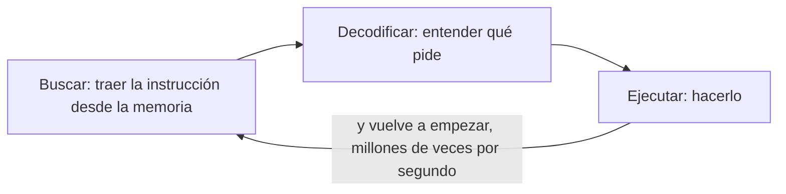
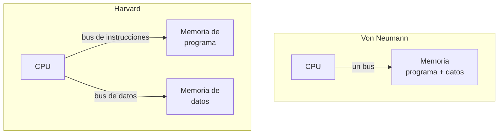

# Semana 1 · Parte 1 — Del computador al microcontrolador

> Apuntes de clase · Sistemas Digitales · Unidad 1: Microcontroladores para sistemas embebidos
> Autor: Jaime Landazuri · Fuente: RECURSOS/S01_Sesion1_Del_computador_al_microcontrolador.pdf · Universidad Nacional de Loja

## Objetivos de la sesión

Al terminar podemos:

1. Nombrar las partes de un computador y cómo se comunican.
2. Distinguir Flash, SRAM y EEPROM.
3. Comparar el ATmega328P y el ESP32.

**Resultado de aprendizaje R1**: diseña arquitectura de microcontroladores.
**Objetivo técnico**: explicar los bloques de un microcontrolador (CPU, buses, memorias y periféricos) y diferenciarlo de un microprocesador.

*Repaso previo (de Arquitectura de Ordenadores): binario y hex, CPU, memoria, buses, ensamblador. Idea extra: tres aparatos de casa con un microcontrolador (lavadora, control remoto, router, termostato, automóvil, alarma).*

## Desarrollo

### ¿Qué es un sistema embebido?

Un aparato con un microcontrolador dentro, **dedicado a una tarea fija**:

- Hace una sola cosa, siempre la misma.
- Tiene recursos limitados: poca memoria, poco consumo.
- Funciona sin que el usuario lo note.
- Muchas veces debe responder a tiempo.

### Microprocesador frente a microcontrolador

| | Microprocesador | Microcontrolador |
|---|---|---|
| Física | Placa: CPU sola, RAM y E/S en otros chips | Un solo chip: CPU + Flash + SRAM + periféricos |
| Ejemplo | PC, laptop | Lavadora, sensor, alarma |
| Propósito | Propósito general | Una tarea |

### Todo computador: tres piezas unidas por buses

- **Bus de direcciones**: ¿qué casillero?
- **Bus de datos**: el contenido.
- **Bus de control**: ¿leer o escribir?

Analogía con un envío por correo: la dirección va en el sobre, la carta va dentro y el sello dice "entregar"; las tres cosas viajan juntas.

### Tres buses, tres preguntas

| Bus | Lleva | Sentido | Ejemplo |
|---|---|---|---|
| Direcciones | Qué casillero | De la CPU hacia afuera | 0x25 |
| Datos | El contenido | En los dos sentidos | 0010 0000 |
| Control | Leer o escribir | Señales sueltas | "escribir" |

### Dentro de la CPU

- **ALU** (unidad aritmético-lógica): suma, resta y hace AND, OR, XOR.
- **Registros**: casilleros internos muy rápidos. El AVR tiene 32: r0 a r31.
- **Unidad de control**: lee cada instrucción y decide qué hacer.
- **Contador de programa (PC)**: guarda la dirección de la siguiente instrucción.

> Núcleo (core) = una CPU completa. El ATmega328P tiene 1 núcleo; el ESP32 tiene 2.

### El ciclo de la CPU: buscar → decodificar → ejecutar

La CPU repite los tres pasos al ritmo del reloj. El reloj a 16 MHz emite 16 millones de pulsos por segundo; cada pulso dura 62,5 ns.

### Ejemplo: escribir y leer un byte

**Escribir 0010 0000 en 0x25**

1. La CPU pone 0x25 en el bus de direcciones.
2. Pone 0010 0000 en el bus de datos.
3. Activa "escribir" en el bus de control.
4. La memoria guarda el byte.

**Leer la dirección 0x25**

1. La CPU pone 0x25 en el bus de direcciones.
2. Activa "leer" en el bus de control.
3. La memoria pone el contenido en el bus de datos.
4. La CPU captura el byte.

### Von Neumann frente a Harvard

- **Von Neumann**: instrucción y dato se traen por turnos, por el mismo bus.
- **Harvard**: dos buses; la siguiente instrucción llega mientras se usa un dato.

El ATmega328P es Harvard. El esquema clásico de un PC es von Neumann.

### Actividad: la CPU humana

Cinco voluntarios: CPU (ejecuta instrucciones), memoria de programa (guarda 4 tarjetas), memoria de datos (0x10 = 5), y buses 1 y 2 (llevan las tarjetas). Instrucciones del programa:

1. Copia el dato de 0x10 a r16
2. Suma 1 a r16
3. Escribe r16 en 0x10
4. Salta a la instrucción 1

Ronda 1, von Neumann: un solo bus trae instrucción y dato. Ronda 2, Harvard: un bus para cada memoria. El resto cuenta viajes y cronometra.

### Tres memorias: ¿qué pasa al apagar?

| Memoria | ¿Se borra al apagar? | Guarda | Analogía |
|---|---|---|---|
| Flash | No se borra | El programa; se reescribe al subir un programa desde el IDE | Un libro |
| SRAM | Se borra | Las variables mientras el programa corre; rápida y pequeña | Una pizarra |
| EEPROM | No se borra | Pocos datos que el programa cambia y deben sobrevivir al apagado | Una libreta |

### Cuánto cabe: KB y MB

| | ATmega328P | ESP32 |
|---|---|---|
| Flash | 32 KB | 4 MB |
| SRAM | 2 KB | ≈ 520 KB |
| EEPROM | 1 KB | No tiene (se emula) |

- 1 byte = 8 bits · 1 KB = 1 024 bytes · 1 MB = 1 024 KB. Ojo: **Mb** (b minúscula) son megabits.
- 1 024 = 2¹⁰: con 10 cables de dirección hay justo 1 024 casilleros.
- 2 KB de SRAM ≈ 2 000 letras. Un arreglo `int[2000]` no cabe en un ATmega328P.

### Escribir desgasta: Flash y EEPROM tienen límite

- 10 000 ciclos garantizados de la Flash.
- 100 000 ciclos garantizados de la EEPROM.

Un ciclo = borrar y volver a escribir la misma celda. **Leer no desgasta.** Cada bit es carga atrapada en un transistor de compuerta flotante; escribir empuja electrones a través de un óxido muy delgado y lo daña un poco cada vez. La SRAM no tiene ese límite.

*Error típico: escribir en la EEPROM dentro de `loop()`. A unas 300 escrituras por segundo, se agota en unos 6 minutos.*

### ¿Dónde lo guardo? (respuesta correcta)

1. El programa de un semáforo → **Flash**
2. La lectura actual del sensor de temperatura → **SRAM**
3. Cuántas veces se abrió una puerta, aunque se vaya la luz → **EEPROM**
4. El contador `i` de un bucle `for` → **SRAM**
5. La temperatura límite que el usuario ajustó con botones → **EEPROM**

### Periféricos: circuitos que trabajan para la CPU

| Periférico | Qué hace | Mapa del curso |
|---|---|---|
| GPIO | Poner un pin en 0 o 1, o leerlo | Sems. 1–2 |
| Timer | Contar pulsos para medir tiempo | Sem. 3 |
| Interrupción | Avisar a la CPU que algo pasó | Sem. 4 |
| ADC | Voltaje → número (ej. sensor LM35) | Sem. 5 |
| PWM | Encender y apagar rápido (servo) | Sem. 12 |
| DAC | Número → voltaje | Sem. 12 |
| UART | Serial por 2 cables (TX, RX) | Sem. 7 |
| I2C | Bus de 2 cables con direcciones | Sem. 7 |
| SPI | Bus rápido de 4 cables | Sem. 7 |

### ATmega328P frente a ESP32

| | ATmega328P | ESP32 |
|---|---|---|
| Fabricante | Microchip (antes Atmel) | Espressif |
| Placa típica | Arduino Uno | ESP32 DevKit V1 |
| Bits y núcleos | 8 bits · 1 núcleo | 32 bits · 2 núcleos |
| Reloj | 16 MHz en el Uno | Hasta 240 MHz |
| Voltaje de los pines | 5 V | 3,3 V (**no** tolera 5 V) |
| Wi-Fi y Bluetooth | No | Sí |
| En el curso | Semana 1, en simulación | Semanas 2 a 16 |

### Chip, módulo y placa

Jerarquía física del ESP32 DevKit V1: dentro de la placa hay un **módulo** (ESP32-WROOM-32: chip, Flash y antena bajo una tapa metálica) y dentro del módulo está el **chip** ESP32.

> Arduino no es un chip: es una plataforma — placas (el Uno lleva un ATmega328P), el Arduino IDE y funciones como `pinMode` y `digitalWrite`. El Arduino IDE también programa el ESP32.

### Sostenibilidad: el MCU mínimo suficiente

- ¿Necesito Wi-Fi? Si no, un MCU sin radio consume menos.
- ¿Cuántos pines y cuánta memoria? Sobredimensionar es gastar energía y material.
- ¿De dónde sale la energía? Con batería, cada miliamperio cuenta.

Menos recursos significa menos consumo y menos residuos electrónicos (e-waste). Los proyectos deben justificar esta elección.

## Resumen

1. Un microcontrolador es CPU, memoria y periféricos en un solo chip.
2. La CPU repite buscar, decodificar y ejecutar al ritmo del reloj.
3. Tres buses: direcciones, datos y control.
4. Harvard separa programa y datos; von Neumann los comparte.
5. Flash: programa · SRAM: variables · EEPROM: datos que sobreviven al apagado.

## Ticket de salida

1. ¿Qué viaja por el bus de direcciones y qué por el bus de datos?
   - *Pauta*: por el bus de direcciones va la ubicación (ej. 0x25); por el de datos, el contenido de esa ubicación (los bytes).
2. ¿Dónde guardas un dato que debe sobrevivir a un apagón?
   - *Pauta*: en la EEPROM (no volátil); la Flash guarda el programa.
3. ¿Por qué Harvard puede ser más rápida que von Neumann?
   - *Pauta*: con dos buses puede buscar la siguiente instrucción mientras usa un dato, sin turnos.

## Tarea

- **Crear una cuenta gratuita en wokwi.com**: la práctica del viernes se hace ahí.
- **Lectura del texto base**: el capítulo y la guía se publican en el EVA.
- **Comprar el ESP32 DevKit V1 y un cable USB de datos**: se usará desde la semana 2.

## Glosario

- **Sistema embebido**: aparato con un microcontrolador dedicado a una tarea fija.
- **Microcontrolador**: CPU, memoria y periféricos en un solo chip.
- **Microprocesador**: solo CPU; memoria y E/S están en otros chips.
- **Bus**: canal de líneas que transporta bits entre los bloques del chip.
- **ALU**: unidad aritmético-lógica de la CPU.
- **Registro**: casillero interno de la CPU; el AVR tiene 32 (r0–r31).
- **Contador de programa (PC)**: registro que guarda la dirección de la siguiente instrucción.
- **Núcleo (core)**: una CPU completa; ATmega328P: 1, ESP32: 2.
- **Flash**: memoria de programa, no volátil.
- **SRAM**: memoria de variables, volátil.
- **EEPROM**: memoria pequeña no volátil para datos que sobreviven al apagado.
- **Harvard**: arquitectura con memorias de programa y de datos separadas (ATmega328P).
- **Von Neumann**: arquitectura con una sola memoria de programa + datos (PC clásico).
