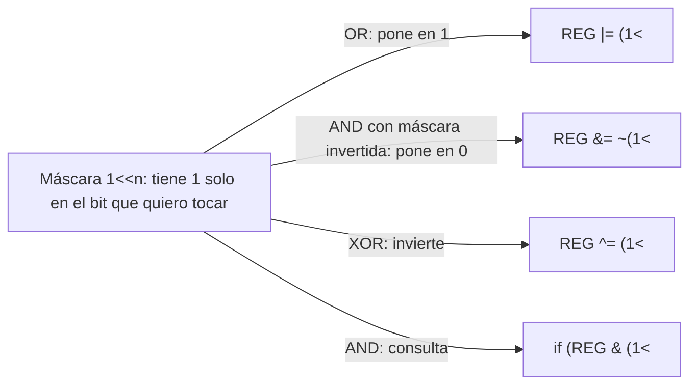
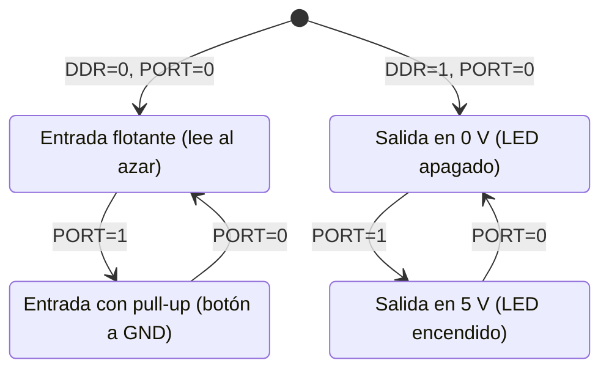

# Semana 1 · Parte 2 — Bits, operaciones bit a bit y E/S mapeada en memoria

> Apuntes de clase · Sistemas Digitales · Unidad 1: Microcontroladores para sistemas embebidos
> Autor: Jaime Landazuri · Fuente: RECURSOS/S01_Sesion2_Bits_y_ES_mapeada_en_memoria.pdf · Universidad Nacional de Loja

## Objetivos de la sesión

Al terminar podemos:

1. Convertir entre binario, decimal y hexadecimal.
2. Encender, apagar o invertir un solo bit.
3. Configurar un pin con DDR, PORT y PIN.

**Objetivo técnico**: aplicar operaciones bit a bit para configurar y controlar pines de E/S mediante los registros DDR, PORT y PIN de un microcontrolador AVR.
**Resultado de aprendizaje R1**: diseña arquitectura de microcontroladores.

*Repaso de la puerta (ticket de salida de la parte 1):
(1) qué viaja por cada bus,
(2) dónde se guarda un dato que sobrevive a un apagón,
(3) por qué Harvard puede ser más rápida que von Neumann.*

## Desarrollo

### Un bit es un nivel de voltaje

| Nivel | Se escribe | Arduino Uno | ESP32 |
|---|---|---|---|
| Bajo | 0 | ≈ 0 V | ≈ 0 V |
| Alto | 1 | ≈ 5 V | ≈ 3,3 V |

Es el transistor como interruptor: en corte da 0, en saturación da 1.

### Un byte: ocho bits, cada uno con su peso

| Peso → | 128 | 64 | 32 | 16 | 8 | 4 | 2 | 1 |
|---|---|---|---|---|---|---|---|---|
| Bit → | 7 | 6 | 5 | 4 | 3 | 2 | 1 | 0 |

- `0010 0000` = 32
- `0000 0101` = 4 + 1 = 5

Los bits se numeran de derecha a izquierda: el bit 0 a la derecha, el bit 7 a la izquierda. El valor es la suma de los pesos de los bits en 1.

### Hexadecimal: 4 bits en un solo símbolo

| Hex | Binario | Hex | Binario |
|---|---|---|---|
| 0 | 0000 | 8 | 1000 |
| 1 | 0001 | 9 | 1001 |
| 2 | 0010 | A | 1010 |
| 3 | 0011 | B | 1011 |
| 4 | 0100 | C | 1100 |
| 5 | 0101 | D | 1101 |
| 6 | 0110 | E | 1110 |
| 7 | 0111 | F | 1111 |

- `0010 0000` = 0x20 (el prefijo `0x` indica hexadecimal).
- En C también existe `0b` para binario: `0b00100000`.

### Actividad: el byte humano

Ocho voluntarios con un cartel de su peso (128, 64, 32, 16, 8, 4, 2, 1). De pie = 1, sentado = 0. La clase dicta: 5 · 32 · 0x81 · 255.

Reto: ¿quién se para con `0x20 | 0x01`? → los pesos 32 y 1: bits 5 y 0.

### Ejercicios de conversión (solución propuesta)

- `1000 0001` = 0x81 = **129**.
- `0xFF` = 1111 1111 = **255**.
- `0x08` → el bit 3 está en 1 (peso 8).
- `200` = 1100 1000 = **0xC8**.

### Las compuertas lógicas, un bit a la vez

| A | B | AND `&` | OR `\|` | XOR `^` | NOT `~` (de A) |
|---|---|---|---|---|---|
| 0 | 0 | 0 | 0 | 0 | 1 |
| 0 | 1 | 0 | 1 | 1 | 1 |
| 1 | 0 | 0 | 1 | 1 | 0 |
| 1 | 1 | 1 | 1 | 0 | 0 |

- AND: 1 solo si ambos son 1.
- OR: 1 si alguno es 1.
- XOR: 1 si son distintos.
- NOT: invierte.

### Bit a bit: columna por columna

```text
  1100 1010
& 0000 1111
---------
  0000 1010
```

Cada columna es un AND independiente; la CPU hace las 8 columnas a la vez, en una sola instrucción.

```c
resultado = 0xCA & 0x0F;  // 0x0A
```

### La máscara: `1 << n` señala un bit

Correr un 1 cinco lugares a la izquierda:

```text
0000 0001  --(1 << 5)-->  0010 0000 = 0x20
```

Una máscara es un byte con 1 solo en los bits que quiero tocar. Escribir `1 << 5` es más legible que `0x20`: dice "el bit 5".

### Las cuatro recetas

| Quiero | En C | Por qué funciona |
|---|---|---|
| Poner el bit n en 1 | `REG \|= (1<<n);` | OR con 1 da 1; OR con 0 deja igual |
| Poner el bit n en 0 | `REG &= ~(1<<n);` | `~` invierte la máscara; AND con 0 da 0 |
| Invertir el bit n | `REG ^= (1<<n);` | XOR con 1 invierte; XOR con 0 deja igual |
| Preguntar por el bit n | `if (REG & (1<<n))` | Queda distinto de 0 solo si el bit está en 1 |

En todos los casos, donde la máscara tiene 0 el bit no cambia. `REG |= X` es la forma corta de `REG = REG | X`.

### Ejercicios (partiendo de REG = 1 0 1 0 1 0 1 0)

1. `REG |= (1<<0);` → 1010 1011 (activa el bit 0).
2. `REG &= ~(1<<7);` → 0010 1010 (apaga el bit 7).
3. `REG ^= 0x0F;` → 1010 0101 (invierte los 4 bits bajos).
4. `if (REG & (1<<3))` → ¿se cumple? Bit 3 de 1010 1010 es 0 → **no se cumple**.
5. Encender los bits 0 y 1 sin tocar los demás: `REG |= 0b11;` (o `REG |= (1<<0) \| (1<<1);`).
6. ¿Qué falla en `REG = (1<<2);` para encender el bit 2? → **Borra los demás bits**: `=` reemplaza todo el byte; para encender sin tocar el resto hay que usar `|=`.



### El juego de instrucciones del AVR

| Instrucción | Qué hace |
|---|---|
| `LDI r16, 0x20` | Carga el número 0x20 en el registro r16 |
| `ADD r16, r17` | Suma r17 a r16 |
| `AND`, `OR`, `EOR`, `COM` | AND, OR, XOR y NOT bit a bit: las instrucciones lógicas |
| `SBI 0x05, 5` | Pone en 1 el bit 5 del registro de E/S 0x05 (PORTB) |
| `CBI 0x05, 5` | Pone en 0 ese mismo bit |
| `RJMP` | Salta a otra parte del programa |

### Demostración: de C a bits

```text
C (lenguaje):        PORTB |= (1 << 5);
Ensamblador:         sbi 0x05, 5
Código máquina:      1001 1010 0010 1101   (0x9A2D)
```

Una línea de C se convierte en una sola instrucción de 2 bytes (compilado con avr-gcc para el ATmega328P).

### RISC y CISC; 8 y 32 bits

| | RISC | CISC |
|---|---|---|
| Idea | Pocas instrucciones, simples; casi todas en un ciclo de reloj | Muchas instrucciones, algunas muy elaboradas |
| Ejemplos | AVR, ARM, RISC-V, Xtensa (ESP32) | x86 (el de los PC) |

8 o 32 bits = cuántos bits procesa la CPU de una vez. El ATmega328P suma 8 bits por instrucción; para sumar números de 32 bits necesita 4 sumas. El ESP32 lo hace en una.

### La idea central: escribir un bit enciende un LED

Registro PORTB (dirección 0x25): escribir `0010 0000` pone en 1 su bit 5; cada bit es un flip-flop que maneja un transistor de salida hacia el pin. El pin PB5 con una resistencia de 220 Ω y un LED: para la CPU es escribir en memoria; para el pin, son 5 V.

```text
CPU                    Registro PORTB (0x25)                pin PB5
sbi 0x05, 5   →   0 0 1 0 0 0 0 0 (bit 5) → transistor → 5 V → LED (con 220 Ω)
```

### Tres registros por puerto

| Registro | Para qué sirve | Bit en 1 significa |
|---|---|---|
| DDRB | Dirección: entrada o salida | Salida |
| PORTB | Salida: el valor que sale. Entrada: activa la pull-up | 5 V en el pin, o pull-up activa |
| PINB | Leer el voltaje real del pin | El pin está en alto |

El bit n de cada registro corresponde al pin n del puerto. El ATmega328P tiene los puertos B, C y D.

### Los cuatro estados de un pin

| DDRxn | PORTxn | Estado del pin | Ejemplo |
|---|---|---|---|
| 0 | 0 | Entrada flotante: lee al azar | Nada conectado |
| 0 | 1 | Entrada con pull-up | Botón a GND |
| 1 | 0 | Salida en 0 (0 V) | LED apagado |
| 1 | 1 | Salida en 1 (5 V) | LED encendido |

> Con pull-up, el botón suelto lee 1 y pulsado lee 0: la lógica queda invertida.



### Actividad: predice el pin

- **A**: DDRB5 = 1, PORTB5 = 1 → el pin es salida → **5 V**.
- **B**: DDRB5 = 1, PORTB5 = 0 → salida → **0 V**.
- **C**: DDRD2 = 0, PORTD2 = 1 (entrada con pull-up, botón pulsado hacia GND) → PIND2 = **0** (lógica invertida).
- **D**: DDRD2 = 0, PORTD2 = 0 (entrada flotante, nada conectado) → PIND2 **lee al azar**, indefinido.

### Lo mismo con funciones de Arduino

| Con funciones de Arduino | Con registros (lo que pasa por dentro) |
|---|---|
| `pinMode(13, OUTPUT);` | `DDRB \|= (1 << 5);` |
| `digitalWrite(13, HIGH);` | `PORTB \|= (1 << 5);` |
| `digitalWrite(13, LOW);` | `PORTB &= ~(1 << 5);` |
| `pinMode(2, INPUT_PULLUP);` | `DDRD &= ~(1 << 2);` + `PORTD \|= (1 << 2);` |
| `int b = digitalRead(2);` | `int b = (PIND & (1 << 2)) != 0;` |

Las funciones son más legibles y portables; los registros son más rápidos y muestran qué ocurre en el chip.

## Resumen

1. Un bit es un nivel de voltaje; un byte son 8 bits; un dígito hex son 4 bits.
2. Las operaciones bit a bit aplican AND, OR, XOR y NOT columna por columna.
3. Con una máscara `1 << n` se toca un solo bit sin cambiar los demás.
4. Los periféricos se controlan con registros que tienen dirección, como la memoria.
5. DDR elige entrada o salida, PORT pone el valor y PIN lee el pin.

## Ticket de salida (con pauta)

1. ¿Cuánto es 0x81 en binario? → `1000 0001`.
2. Escribe la línea que apaga el bit 4 de PORTB. → `PORTB &= ~(1 << 4);`
3. Con DDRD2 = 0 y PORTD2 = 1, ¿qué lee PIND2 con el botón pulsado a GND? → **0** (con pull-up, pulsado = 0).

## Glosario

- **Bit**: nivel de voltaje lógico: 0 (bajo) o 1 (alto).
- **Byte**: grupo de 8 bits, con pesos 128…1, numerados del bit 7 al bit 0.
- **Hexadecimal**: base 16; un dígito hex codifica 4 bits; prefijo `0x`.
- **Máscara**: byte con 1 solo en los bits que se quieren tocar.
- **Flip-flop**: circuito digital que guarda un bit.
- **Port/puerto**: grupo de pines (B, C, D en el ATmega328P).
- **DDR (x)**: registro de dirección: 1 = salida, 0 = entrada.
- **PORT (x)**: registro de valor de salida; en entrada, activa la pull-up.
- **PIN (x)**: registro de lectura del voltaje real del pin.
- **Pull-up**: resistencia interna que mantiene el pin en 1 cuando nada lo conecta a otro nivel.
- **Entrada flotante**: pin de entrada sin pull-up ni conexión externa; lee valores al azar.
- **RISC / CISC**: filosofía de pocas instrucciones simples (AVR, Xtensa) frente a muchas elaboradas (x86).
