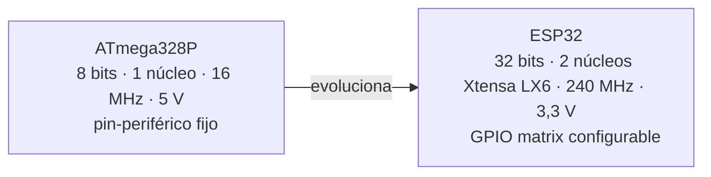
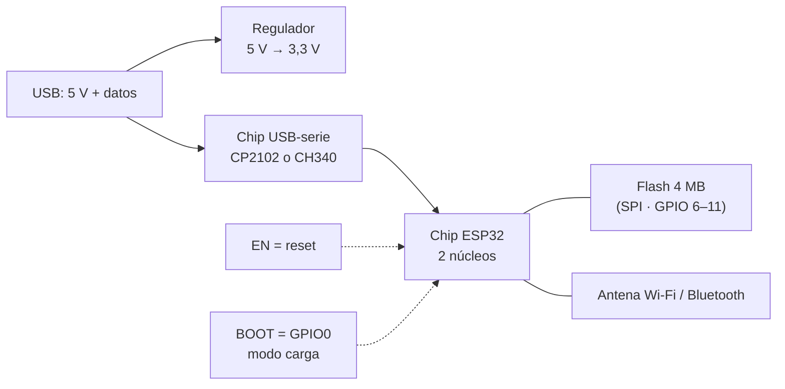
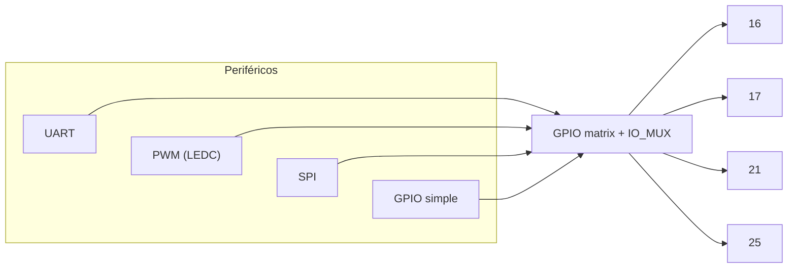
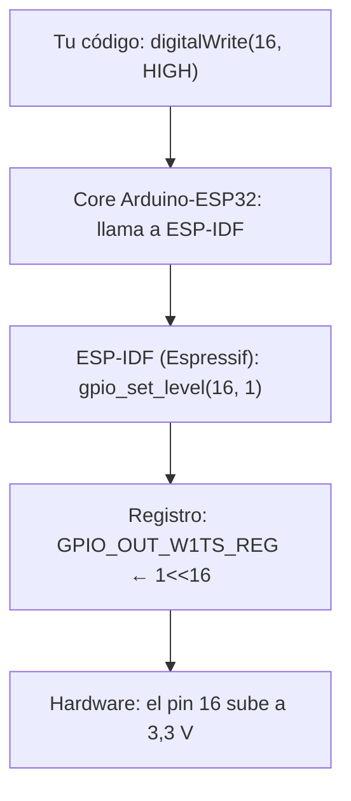
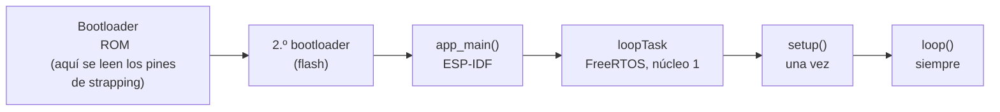

# Semana 2 · Parte 1 — Del AVR al ESP32: pines, registros y el programa que nunca termina

> Apuntes de clase · Sistemas Digitales · Unidad 1: Microcontroladores para sistemas embebidos
> Autor: Jaime Landazuri · Fuente: RECURSOS/S2_Sesion1_Del_AVR_al_ESP32.pdf · Universidad Nacional de Loja

## Objetivos de la sesión

Al finalizar podemos:

1. Relacionar los registros GPIO del ESP32 con DDR, PORT y PIN del AVR.
2. Elegir pines seguros del ESP32 DevKit V1 y justificar las restricciones eléctricas y de arranque.
3. Explicar cómo arranca y se ejecuta un programa embebido (setup, loop y superlazo).

**Resultado de aprendizaje** R1: diseña arquitectura de microcontroladores, bajo los principios de solidaridad, transparencia, responsabilidad y honestidad.

*Activación: ¿qué hace cada línea? (recuerden la semana 1)*

```c
DDRB |= (1 << PB5);      // ① dirección: salida (1) para el bit 5
PORTB |= (1 << PB5);     // ② salida: pin en alto (5 V)
if (PIND & (1 << PD2))   // ③ entrada: ¿el pin 2 está en alto?
```

Pregunta clave: si el ESP32 no tiene DDRB, PORTB ni PINB… ¿se pierde todo lo aprendido? → No: la idea es la misma, cambian los nombres.

## Desarrollo

### Parte 1 · Del AVR al ESP32: la misma idea, otros nombres, 32 bits

#### De la tienda de barrio al supermercado

| | ATmega328P (semana 1) | ESP32-WROOM-32 |
|---|---|---|
| Ancho de palabra | 8 bits | 32 bits |
| Núcleos / reloj | 1 núcleo · 16 MHz | 2 núcleos Xtensa LX6 · hasta 240 MHz |
| SRAM | 2 KB | 520 KB |
| Flash | 32 KB, dentro del chip | 4 MB, chip aparte en el módulo (SPI) |
| Tensión lógica | 5 V | 3,3 V |
| Pin ↔ periférico | Fijo (PB5 = bit 5 de PORTB) | Configurable (**GPIO matrix**) |

Lo que NO cambia: **un pin se controla escribiendo bits en registros mapeados en memoria**.



#### La placa DevKit V1 por dentro



- USB 5 V + datos; regulador 5 V → 3,3 V; chip USB-serie (CP2102 o CH340).
- Chip ESP32 de 2 núcleos + Flash de 4 MB conectada por SPI (pines internos GPIO 6–11) + antena Wi-Fi/Bluetooth.
- Botones EN (reset) y BOOT (= GPIO0, modo carga).
- Usaremos el DevKit V1 de 30 pines: **verificar la serigrafía**, los clones cambian el orden de pines.

#### Entre pines y periféricos hay una central

- **AVR: cableado fijo**. Configurar un pin AVR = el bit 5 de PORTB va directo a PB5.
- **ESP32: central configurable**. Entre periféricos (UART, PWM/LEDC, SPI, GPIO simple) y los pines hay una **GPIO matrix + IO_MUX**.

Configurar un pin = 3 pasos: elegir su función (IO_MUX), conectar la señal en la matrix, habilitar la salida. `pinMode()` hace los tres por nosotros.



#### DDR, PORT y PIN tienen equivalentes

| Función | AVR (semana 1) | ESP32 (GPIO 0–31) |
|---|---|---|
| Dirección (entrada/salida) | DDRB | GPIO_ENABLE_REG |
| Escribir la salida | PORTB | GPIO_OUT_W1TS_REG / GPIO_OUT_W1TC_REG |
| Leer la entrada | PINB | GPIO_IN_REG |
| Pull-up interna | PORTB (con el pin como entrada) | registro IO_MUX de cada pin |

> GPIO 32–39 no caben en un registro de 32 bits: usan un segundo banco (GPIO_OUT1_REG, GPIO_IN1_REG).

#### El riesgo de leer, modificar y escribir (read-modify-write)

Interupción hipotética: otra instrucción hace `PORTB |= (1<<PB0)` (PORTB = 0010 0001), mientras el código hace:

```text
in   → copia PORTB: 0010 0000
eor  → calcula sobre la copia: 0000 0000
out  → escribe: 0000 0000
```

Resultado: PORTB = 0000 0000 → **el cambio de la interrupción se perdió**. Con dos núcleos el riesgo es mayor.

#### W1TS y W1TC: notas de "encender" y "apagar"

| Registro | Significado | Bits en 1 | Bits en 0 |
|---|---|---|---|
| W1TS · write 1 to set | nota de "encender" | se ENCIENDEN | no se tocan |
| W1TC · write 1 to clear | nota de "apagar" | se APAGAN | no se tocan |

```text
GPIO_OUT antes     0 1 0 1
escribo en W1TS    0 0 1 0     → solo pone en 1 los bits con "1" en la máscara
GPIO_OUT después   0 1 1 1
```

Una sola escritura, sin leer antes → **la operación es atómica**: resuelve el problema read-modify-write.

#### Ejemplo: Blink con registros del ESP32

```c
#include "soc/gpio_reg.h"
constexpr uint8_t PIN_LED = 16;
constexpr uint32_t MASK_LED = 1UL << PIN_LED;

void setup() {
  pinMode(PIN_LED, OUTPUT);                     // configura
}

void loop() {
  REG_WRITE(GPIO_OUT_W1TS_REG, MASK_LED);       // equivalente a PORTB |=
  delay(500);
  REG_WRITE(GPIO_OUT_W1TC_REG, MASK_LED);       // equivalente a PORTB &= ~
  delay(500);
}
```

Montaje: LED en GPIO16, 330 Ω a GND. Placa: ESP32 Dev Module, Core Espressif 3.x. `pinMode()` configura; los registros leen y escriben.

#### Capas de abstracción



Mientras se baja, **más fácil** hasta arriba y **más control y velocidad** hasta abajo. La API cuesta tiempo (recuerden la Parte D de la AP1).

#### Mapa de pines del DevKit V1 (30 pines)

- **Seguros** para LEDs y pulsadores (sin efectos de arranque): pines como 4, 5, 13, 14, 16–19, 21, 22, 23, 25–27, 32, 33.
- **Strapping**: el chip los lee al arrancar (0, 2, 5, 12, 15).
- **Solo entrada, sin pull-up interna**: 34, 35, 36 (VP), 39 (VN).
- **UART0** (1 = TX0, 3 = RX0): carga y Monitor Serie.
- **Alimentación y reset**: EN, GND, VIN, 3V3.
- Los pines 6–11 (flash) **no salen** en esta placa.

AP2: LEDs en 16, 17, 18, 19 y pulsador en 21.

#### Pines de strapping: el chip los mira al despertar

| Pin | Condición de arranque | Consecuencia |
|---|---|---|
| GPIO0 | En BAJO al arrancar | Modo de carga (es el botón BOOT) |
| GPIO2 | Debe estar en bajo o al aire para cargar | Suele tener el LED azul de la placa |
| GPIO12 | En ALTO al arrancar | Flash a 1,8 V → la placa no arranca |
| GPIO5 y GPIO15 | También se leen al arrancar | — |

Regla práctica: **no conectar entradas a pines de strapping**. Wokwi NO reproduce estas fallas: solo aparecen con la placa real.

#### 3,3 V: los límites eléctricos

- Diseño por pin: ≤ 10 mA. Máximo en una entrada: 3,3 V. Un LED azul con 330 Ω se queda con 0,3 V de margen.
- Fórmula: `R = (3,3 V − Vf) / I`. LED rojo Vf ≈ 2,0 V: (3,3 − 2,0) / 330 ≈ 4 mA.
- **No toleran 5 V**: un sensor o módulo de 5 V conectado directo a una entrada puede dañar el pin.
- LEDs recomendados: rojo, verde o amarillo con 220–330 Ω (azul y blanco casi no encienden a 3,3 V con resistencia).

#### Actividad: ¿dónde lo conecto? (respuesta ▢/✘ con justificación)

| | Montaje | Veredicto y por qué |
|---|---|---|
| A | LED en GPIO18 | ✅ Pin seguro de salida |
| B | Pulsador en GPIO35 con INPUT_PULLUP | ✘ GPIO 34–39 no tienen pull-up interna |
| C | LED en GPIO2 | ⚠ Strapping: LED azul de la placa; evita como salida externa |
| D | Pulsador entre GPIO12 y 3,3 V | ✘ Strapping: si está en ALTO al arrancar, flash a 1,8 V y la placa no arranca |
| E | Sensor que entrega 5 V en GPIO4 | ✘ 3,3 V máximo: daña el pin |
| F | LED en GPIO1 | ✘ UART0 (TX0): necesario para carga y Monitor Serie |

### Parte 2 · El programa que nunca termina

#### El visitante y el guardia nocturno

| Programa de PC · el visitante | Programa embebido · el guardia |
|---|---|
| Lo lanza el sistema operativo | Arranca con la alimentación |
| Hace su trabajo | Configura una vez |
| `main()` termina con `return 0` | Repite su ronda para siempre |
| El SO recupera el control | Solo termina si se corta la energía |

En un microcontrolador **no existe un "fin del programa"**.

#### Del reset a loop()



Antes de `setup()`: las globales inicializadas se copian de la flash a la SRAM. Todo sketch del ESP32 ya corre sobre FreeRTOS (Unidad 2).

#### El superlazo: setup() y loop()

Concepto de `setup()` (una vez) y `loop()` (para siempre): leer entradas → decidir → escribir salidas.

Otra lectura de la ideología: lo que Arduino esconde (AVR):

```c
int main() {
  init();              // timers, ADC...
  setup();
  for (;;) {
    loop();
  }
}
```

En el ESP32, `loopTask` hace lo mismo.

#### Predicción: ¿qué imprime en la 3.ª pasada?

```c
int contadorGlobal = 0;

void setup() { Serial.begin(115200); }
void loop() {
  int contadorLocal = 0;
  static int contadorStatic = 0;

  contadorGlobal++; contadorLocal++; contadorStatic++;
  Serial.print("global="); Serial.print(contadorGlobal);
  Serial.print(" local="); Serial.print(contadorLocal);
  Serial.print(" static="); Serial.println(contadorStatic);
  delay(1000);
}
```

En la 3.ª pasada: `global = 3` (sobrevive entre pasadas), `local = 1` (se recrea cada llamada), `static = 3` (conserva su valor entre llamadas).

#### Lo que cuesta un loop() vacío

- **Activo**: a 240 MHz la CPU ejecuta instrucciones sin parar: decenas de mA, girando aunque `loop()` no tenga nada que hacer.
- **Deep sleep**: casi todo se apaga y un temporizador lo despierta: del orden de µA.

Para los proyectos: ¿el dispositivo necesita estar despierto todo el tiempo? (Cifras de orden de magnitud: verificar en el datasheet de Espressif.)

### Parte 3 · Manos a la herramienta: Arduino IDE + core Espressif 3.x

#### Instalar el core ESP32 en Arduino IDE 2.x (4 pasos)

1. **Preferencias**: agregar la URL del gestor de placas de Espressif — `https://espressif.github.io/arduino-esp32/package_esp32_index.json`
2. **Gestor de placas**: instalar «esp32 by Espressif Systems» 3.x (no confundir con «Arduino ESP32 Boards»).
3. **Placa**: elegir «ESP32 Dev Module».
4. **Puerto + driver**: COMx o `/dev/ttyUSB0`; driver CP210x o CH340.

> Instalar en casa: el core pesa varios cientos de MB.

#### Cuando el programa no sube

| Síntoma | Causa probable | Solución |
|---|---|---|
| No aparece ningún puerto | Cable solo de carga o falta driver | Otro cable · driver CP210x/CH340 |
| Wrong boot mode / Timed out | No entró en modo de carga | Mantener BOOT en «Connecting…» |
| Access denied | Puerto ocupado por otra ventana | Cerrar el otro Monitor Serie |
| Caracteres basura | Velocidad distinta | 115200 en `Serial.begin` y Monitor |
| Brownout detector | Alimentación débil | Otro puerto USB o cable |
| No arranca con el circuito | Pin de strapping forzado | Mover a un pin seguro |

## Resumen

1. **Registros**: DDR/PORT/PIN → ENABLE / OUT (W1TS, W1TC) / IN.
2. **Atomicidad**: W1TS y W1TC escriben sin leer: nada se pierde.
3. **Pines**: seguros · strapping · solo entrada · UART0 · 3,3 V.
4. **Programa**: setup() una vez, loop() siempre, sobre FreeRTOS.

## Tarea para mañana

1. **Instalar** Arduino IDE 2.x + core «esp32 by Espressif Systems» 3.x (en casa).
2. **Probar en Wokwi** Blink con registros en el ESP32 DevKit (LED en GPIO16).
3. **Probar la placa** en grupos: cargar Blink con el LED de la placa.
4. **Leer** la lectura del texto base indicada en el EVA.

> Mañana: control de aprendizaje. Viernes: AP2 con ESP32 → traer la placa y un cable USB de datos.

## Glosario

- **GPIO matrix / IO_MUX**: central de conmutación del ESP32 que conecta periféricos con pines de forma configurable (en el AVR el cableado es fijo).
- **W1TS / W1TC**: registros write-1-to-set / write-1-to-clear: una escritura enciende o apaga solo los bits con 1 en la máscara, sin leer antes (operación atómica).
- **Read-modify-write**: leer, modificar y reescribir un registro; no atómico: puede perder cambios de una interrupción o del otro núcleo.
- **Strapping**: pines que el chip lee al arrancar (0, 2, 5, 12, 15); condicionan el modo de carga y el voltaje del flash.
- **GPIO 34–39**: pines de solo entrada, sin pull-up interna, en el segundo banco de registros (GPIO_OUT1/IN1).
- **CP2102 / CH340**: chips USB-serie del DevKit; definen el driver a instalar.
- **Brownout detector**: detección de alimentación insuficiente que reinicia la placa.
- **Superlazo**: estructura `setup()` una vez + `loop()` para siempre (`for(;;)` de main).
- **FreeRTOS**: sistema operativo en tiempo real sobre el que ya corre todo sketch del ESP32 (loopTask, núcleo 1).
- **Deep sleep**: modo de energía donde casi todo se apaga y un temporizador despierta el chip (µA frente a mA activos).
