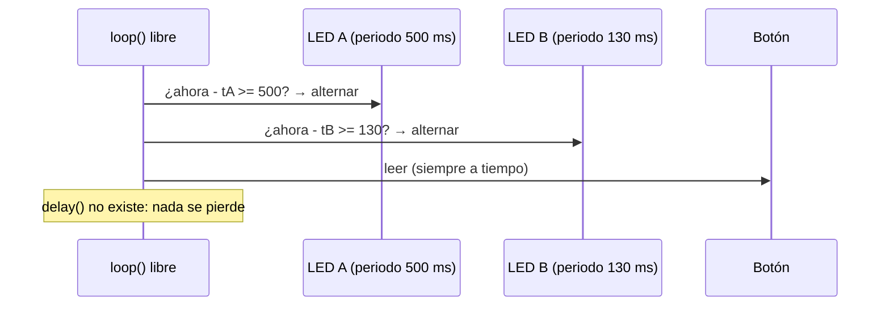
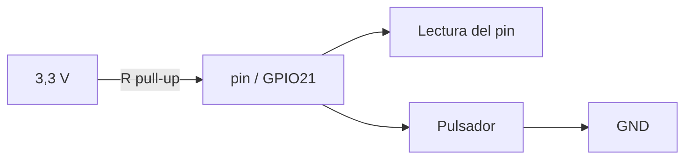
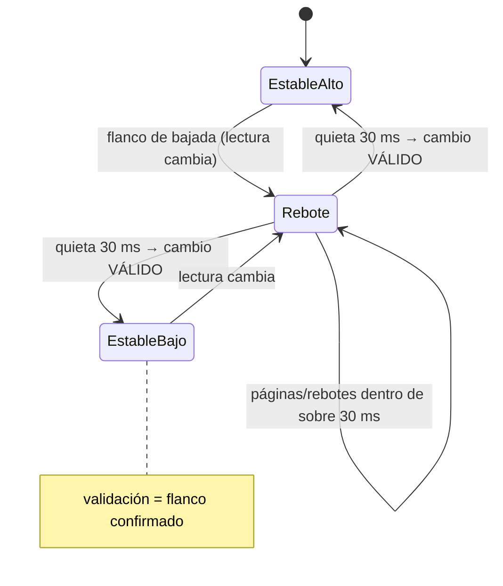

# Semana 2 · Parte 2 — Programar para el hardware: tipos de datos, tiempo sin bloquear y pulsadores

> Apuntes de clase · Sistemas Digitales · Unidad 1: Microcontroladores para sistemas embebidos
> Autor: Jaime Landazuri · Fuente: RECURSOS/S2_Sesion2_Tipos_Tiempo_Pulsadores.pdf · Universidad Nacional de Loja

## Objetivos de la sesión

Al finalizar podemos:

1. Elegir tipos de datos de tamaño explícito y prever desbordamientos y promociones.
2. Implementar temporización no bloqueante con `millis()`.
3. Leer un pulsador con pull-up, antirrebote y detección de flanco.

**Resultado de aprendizaje** R1: diseña arquitectura de microcontroladores (solidaridad, transparencia, responsabilidad y honestidad).

> Todo lo de hoy se usa el viernes en la AP2: Juego de luces interactivo.

*Activación: ¿qué imprime?*

```c
uint8_t a = 0xCC;          // 1100 1100
Serial.println(~a, BIN);   // ¿?  Pista: ¿cuántos bits tiene un int?
```

Respuesta (con core ESP32, `int` de 32 bits): `~a` se promociona a `int` de 32 bits → imprime `1111 ... 00110011` con 32 bits. Con `(uint8_t)~a` vuelve a 8 bits: `00110011`. Es la pregunta 6 de la AP1; hoy entendemos por qué.

## Desarrollo

### Parte 1 · Tipos de datos: una variable es una caja en la SRAM

#### Tamaño e interpretación

Un mismo byte en SRAM (`1100 1100`):

| Tipo | Interpretación | Valor |
|---|---|---|
| uint8_t | sin signo | 204 |
| int8_t | con signo (bit alto = signo) | −52 |

El tipo define: el **tamaño de la caja** y **cómo se leen sus bits**.

#### int no mide lo mismo en todas partes

| Tipo | AVR (Uno) | ESP32 | Ojo |
|---|---|---|---|
| char | 1 · con signo | 1 · sin signo | usar int8_t / uint8_t |
| short | 2 | 2 | |
| int | 2 | 4 | ¡cambia de tamaño! |
| long | 4 | 4 | |
| float | 4 | 4 (FPU) | rápido en el ESP32 |
| double | 4 (= float) | 8 (software) | lento en el ESP32 |
| puntero | 2 | 4 | |

Tamaños en bytes. ESP32 verificado con el core Espressif 3.0.7.

#### stdint.h: el tamaño va en el nombre

| Tipo | Rango |
|---|---|
| int8_t | −128 … 127 |
| uint8_t | 0 … 255 |
| int16_t | −32 768 … 32 767 |
| uint16_t | 0 … 65 535 |
| int32_t | ≈ ±2,1 × 10⁹ |
| uint32_t | 0 … ≈ 4,29 × 10⁹ |

`u` = sin signo · número = bits · `_t` = tipo. Usar tipos de stdint.h para: registros y máscaras, protocolos y tramas, arreglos grandes, **tiempos (uint32_t)**.

#### Desbordamiento: el odómetro que da la vuelta

`uint8_t c = 253;` → con 5 incrementos: 253, 254, 255, **0**, 1…

- **Sin signo**: da la vuelta — comportamiento definido.
- **Con signo**: comportamiento indefinido. No confiar en él.

Error clásico con `millis()`:

```c
int t = millis();   // ✘
```

- AVR: `int` de 2 bits (16) → falla a los ~32 s.
- ESP32: `int` de 32 bits (con signo) → falla a los ~24,8 días.
- Solución: **usar uint32_t**.

#### Demo: detector de plataforma

```c
#define MOSTRAR(T) do { Serial.print(#T); Serial.print(": "); \
    Serial.print(sizeof(T)); Serial.println(" bytes"); } while (0)

void setup() {
  Serial.begin(115200);
  MOSTRAR(char); MOSTRAR(int); MOSTRAR(long);
  MOSTRAR(float); MOSTRAR(double); MOSTRAR(void*);

  uint8_t c = 253;                              // desbordamiento
  for (int i = 0; i < 5; i++) { Serial.print(c++); Serial.print(' '); }
  Serial.println();

  uint8_t a = 0xCC;                             // promoción
  Serial.println(~a, BIN);                      // imprime 32 bits
  Serial.println((uint8_t)~a, BIN);             // vuelve a 8 bits
}
void loop() {}
```

Mismo código en mitad del curso: Arduino Uno (Wokwi) y otra mitad: ESP32 DevKit (Wokwi) — los tamaños difieren.

#### Máscaras: el 1 también tiene tipo

```c
// ✘ Riesgoso
uint32_t m = 1 << 31;    // int con signo: desborda un int con signo

// Correcto
uint32_t m = 1UL << 31;  // literal de 32 bits sin signo
```

Promoción a int: `~a` sin cast da 32 bits; `(uint8_t)~a` vuelve a 8 bits. Literales: `0x` hex · `0b` binario · `U` sin signo · `UL` unsigned long.

#### Constantes con tipo

| Forma | Qué es | ¿Tipo? | Uso |
|---|---|---|---|
| `#define LED 16` | reemplazo de texto | no | solo por compatibilidad |
| `const uint8_t LED = 16;` | constante verificada | sí | |
| `constexpr uint8_t LED = 16;` | calculada al compilar | sí | la usaremos |
| `enum Modo { LENTO, RAPIDO };` | estados con nombre | sí | modos del juego |

En el ESP32, una `const` global se queda en la flash. En el AVR se copia a la SRAM, salvo `PROGMEM` o `F()`.

#### volatile y static

- **volatile**: «Este valor puede cambiar sin que lo veas». Para variables que modifica una **interrupción o el hardware**. No significa atómico.
- **static**: dentro de una función, conserva su valor entre llamadas; en un archivo, es privada de ese archivo.

> Las variables locales viven en la pila de loopTask (**8 KB**): un arreglo local grande la desborda y el ESP32 se reinicia.

#### Actividad: encuentra el bug (en parejas, 6 min)

| | Código | Error y corrección |
|---|---|---|
| A | `for (uint8_t i = 0; i < 256; i++) Serial.println(i);` | Bucle infinito: uint8_t nunca es ≥ 256 (da la vuelta a 0). Usar uint16_t o `i < 255` + tratamiento aparte. |
| B | `if (millis() > tAnterior + PERIODO) …` (padrón: comparar sumando) | Viene de la clase: comparar con resta `millis() - tAnterior >= PERIODO`; la suma da la vuelta antes de tiempo. |
| C | `uint32_t m = 1 << 31;` | `1` es int con signo → desbordamiento. Usar `1UL << 31`. |
| D | `void loop() { int veces = 0; veces++; }` | El contador se reinicia en cada llamada: usar `static int` o global. |

### Parte 2 · El tiempo sin bloquear: delay() frente a millis()

#### delay(): el cocinero que mira el horno

```mermaid
sequenceDiagram
    participant LOOP as loop()
    participant BOT as Botón
    Note over LOOP: lee botón
    LOOP->>LOOP: delay(500) · bloqueado
    BOT->>BOT: presiona y suelta
    Note over BOT,LOOP: → nadie lo leyó: pulsación perdida
    LOOP->>LOOP: lee botón (tarde)
    LOOP->>LOOP: delay(500) · bloqueado
```

`delay()` **bloquea**: mientras espera, el programa no hace nada más. En un juego de luces, el botón "no responde".

#### millis(): mirar el reloj de pared

```c
uint32_t ahora = millis();

if (ahora - tAnterior >= PERIODO) {
  tAnterior += PERIODO;
  // hacer algo
}
// el loop sigue: hay tiempo para leer botones
```

El patrón: 1. Leer el reloj → 2. Restar: ¿cuánto pasó? → 3. Si ya toca: actuar y anotar → 4. Seguir con lo demás.

> Un temporizador de hardware cuenta siempre; `millis()` solo lo mira. Los timers son el tema de la semana 3.

#### ¿Y cuando millis() da la vuelta?

Con un reloj de 8 bits (255 → 0): `tAnterior = 250`, `ahora = 4`.

- ✘ Sumar y comparar: `millis() > tAnterior + PERIODO` → la suma da la vuelta y la condición se cumple antes de tiempo.
- ✅ Restar: `ahora − tAnterior = 4 − 250 = 10` (módulo 256) → es justo el tiempo que pasó.

La aritmética sin signo en módulo 2ⁿ hace que la **resta** sea correcta aunque el contador dé la vuelta.

#### Ejemplo: dos LEDs a ritmos distintos

```c
constexpr uint8_t LED_A = 16, LED_B = 17;
constexpr uint32_t PERIODO_A = 500, PERIODO_B = 130;    // ms
uint32_t tA = 0, tB = 0;
bool estadoA = false, estadoB = false;

void setup() { pinMode(LED_A, OUTPUT); pinMode(LED_B, OUTPUT); }

void loop() {
  uint32_t ahora = millis();
  if (ahora - tA >= PERIODO_A) {
    tA += PERIODO_A; estadoA = !estadoA; digitalWrite(LED_A, estadoA);
  }
  if (ahora - tB >= PERIODO_B) {
    tB += PERIODO_B; estadoB = !estadoB; digitalWrite(LED_B, estadoB);
  }
}
```

Montaje: LEDs en GPIO16 y GPIO17 con 330 Ω a GND. El estado vive en variables, **no en el pin**.



### Parte 3 · Leer un pulsador bien: pull-up, rebote y flanco

#### Pull-up: darle al pin un nivel definido

La pull-up interna (decenas de kΩ) conecta suavemente el pin a 3,3 V; el botón conecta el pin a GND.

| Pulsador | Lectura |
|---|---|
| Suelto | HIGH (1) |
| Presionado | LOW (0) |

```c
pinMode(21, INPUT_PULLUP);   // pulsador entre GPIO21 y GND
```

> GPIO 34–39: sin pull-up interna.



#### El rebote: la pelota que no se queda quieta

Al pulsar, la señal mecánica rebota: lalectura HIGH/LOW oscila unos milisegundos. **Antirrebote**: aceptar el cambio solo si la señal se queda quieta entre **20 y 50 ms** (se usa 30 ms).

Solución tentadora pero mala: `delay(200)` después de leer — vuelve a bloquear el programa.



#### Nivel frente a flanco

- Un toque humano dura ~200 ms; el código de `loop()` da **miles de vueltas** durante ese "nivel" LOW.
- ✘ **Cuenta por nivel**: `if (digitalRead(BTN) == LOW) contador++;` → cuenta muchas veces.
- ✅ **Cuenta por flanco**: actuar solo cuando el estado pasa de HIGH a LOW (flanco de bajada: UNA vez).

#### Código: antirrebote y flanco

```c
constexpr uint8_t PIN_BTN = 21;
constexpr uint32_t T_REBOTE = 30;                  // ms
bool lecturaAnterior = HIGH, estadoEstable = HIGH;
uint32_t tUltimoCambio = 0;
uint16_t pulsaciones = 0;

void setup() {
  Serial.begin(115200);
  pinMode(PIN_BTN, INPUT_PULLUP);
}

void loop() {
  // 1) leer
  bool lectura = digitalRead(PIN_BTN);
  // 2) ¿se movió? → reiniciar el cronómetro
  if (lectura != lecturaAnterior) {
    tUltimoCambio = millis();
    lecturaAnterior = lectura;
  }
  // 3) ¿quieta 30 ms?  +  4) ¿es un flanco (es distinto del estado estable)?
  if (millis() - tUltimoCambio >= T_REBOTE && lectura != estadoEstable) {
    estadoEstable = lectura;                       // cambio real
    if (estadoEstable == LOW) {                    // flanco de bajada
      pulsaciones++; Serial.println(pulsaciones);
    }
  }
}
```

#### Todo junto: la estructura de un juego de luces

```c
void loop() {
  // 1) Entradas: botón con antirrebote y flanco
  if (botonPresionado()) velocidad = (velocidad + 1) % N_VEL;

  // 2) Lógica: estado + millis()
  uint32_t ahora = millis();
  if (ahora - tPaso >= PERIODOS[velocidad]) {
    tPaso = ahora;
    posicion = (posicion + 1) % N_LEDS;
  }

  // 3) Salidas: LEDs según el estado
  for (uint8_t i = 0; i < N_LEDS; i++)
    digitalWrite(LEDS[i], i == posicion);
}
```

Estructura **Entradas → Lógica → Salidas**: leer una vez por vuelta, decidir con el estado, escribir los pines siempre al final.

## Resumen

1. **Tipos**: `int` cambia de tamaño: usar `uint8_t`, `uint32_t`…
2. **Literales y máscaras**: `1UL << n` · cast tras `~` · desbordamiento sin signo da la vuelta.
3. **Tiempo**: `millis()` + resta: `ahora − tAnterior >= PERIODO`.
4. **Pulsador**: INPUT_PULLUP · antirrebote 30 ms · actuar en el flanco.

## Control de aprendizaje 1

20 min, en el EVA, individual. Cubre: registros GPIO del ESP32 y pines seguros, setup()/loop() y el superlazo, tipos de datos/desbordamiento/máscaras, millis() y el pulsador.

## Tarea: preparar la AP2

1. **Leer** la guía de la AP2 en el EVA.
2. **Traer** la placa ESP32 del grupo y un cable USB de datos.
3. **Instalar** Arduino IDE 2.x + core esp32 3.x (si no se hizo).
4. **AA 1-2**: revisar el catálogo de temas del proyecto de unidad en el EVA.

> Viernes: AP2 · Juego de luces interactivo con ESP32. Los grupos sin placa trabajan en Wokwi.

## Glosario

- **Tamaño explícito (stdint.h)**: tipos con el ancho en el nombre (uint8_t, uint32_t); portables entre plataformas.
- **Desbordamiento (unsigned)**: la vuelta del odómetro en módulo 2ⁿ; en sin signo es definido, en con signo es indefinido.
- **Promoción**: conversión implícita a `int` de mayor tamaño al evaluar expresiones (afecta a `~` y `<<`).
- **Literal UL**: sufijo `U`/`UL` que marca un literal sin signo; imprescindible en `1UL << 31`.
- **constexpr**: constante calculada al compilar; preferida frente a `#define`.
- **volatile**: avisa al compilador de que el valor puede cambiar fuera del flujo (interrupciones/hardware); no garantiza atomicidad.
- **static (local)**: conserva el valor entre llamadas de la función.
- **Pila de loopTask**: pila de 8 KB del hilo del sketch en ESP32; los arreglos locales grandes la desbordan.
- **Bloqueante / no bloqueante**: `delay()` detiene el programa; el patrón `millis()` sigue atendiendo entradas.
- **Pull-up**: resistencia interna que pone el pin en 1 cuando el botón no lo conecta a GND; lógica invertida (suelto = HIGH).
- **Rebote (bounce)**: oscilaciones mecánicas de contacto al pulsar; se filtran esperando 20–50 ms de señal quieta.
- **Flanco**: cambio de nivel (HIGH→LOW = bajada); actuar una sola vez frente a contar por nivel.
