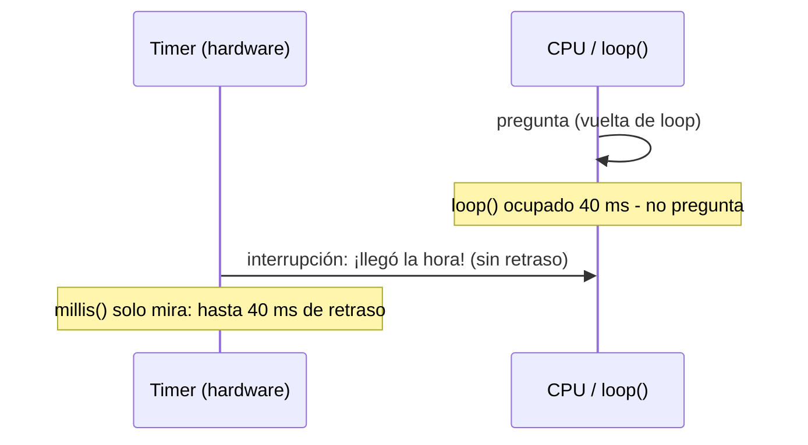
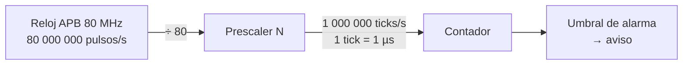

# Semana 3 · Parte 1 — Temporizadores de hardware en el ESP32 (I): qué es, cómo cuenta y las fórmulas

> Apuntes de clase · Sistemas Digitales · Unidad 1: Microcontroladores para sistemas embebidos
> Autor: Jaime Landazuri · Fuente: RECURSOS/S3_Temporizadores_ESP32.pdf · Universidad Nacional de Loja

## Objetivos de la sesión

Al terminar, podemos:

1. **Explicar** qué es un temporizador y cómo cuenta.
2. **Calcular** resolución y valor de alarma.
3. **Describir** la interrupción y cómo la CPU se entera.

**Resultado de aprendizaje R1**: diseña arquitectura de microcontroladores.

## Desarrollo

### Repaso de la semana 2

#### El número de GPIO es un nombre, no una posición

- **30** pines en la placa DevKit V1 · **25** de esos pines son GPIO · **34** GPIO existen en el chip ESP32.
- GPIO18 es el *nombre* de una señal del chip, no "el pin número 18 de la placa".
- En el chip **no existen** GPIO20, GPIO24 ni GPIO28–31: la numeración tiene huecos.
- Siempre se busca el rótulo impreso en la placa y el diagrama de pines.

#### Los GPIO 34 a 39 solo sirven como entrada

| GPIO | Rótulo frecuente | ¿Salida? | ¿Pull-up interna? | Por qué |
|---|---|---|---|---|
| 34, 35 | D34, D35 | No | No | No tienen driver de salida (el circuito que entrega corriente hacia afuera) ni resistencia de pull-up interna. Solo "escuchan". |
| 36 | VP | No | No | igual |
| 39 | VN | No | No | igual |

> ⚠ Un LED en el GPIO34 nunca se enciende, aunque el código compile sin errores.

#### Variable local frente a variable static

| Local = vaso desechable | static = taza en tu escritorio |
|---|---|
| Se crea al entrar a la función y se tira al salir. En cada vuelta de `loop()` empieza de nuevo con su valor inicial. | Se crea una sola vez y se queda. Cada vuelta de `loop()` encuentra el valor que dejó la anterior. |

```c
void loop() {
  int    a = 0; a++;    // a vale 1 en TODAS las vueltas
  static int b = 0; b++; // b vale 1, 2, 3, 4...
}
```

#### Promoción a int: el compilador convierte antes de operar

```c
uint8_t x = 200, y = 100;
uint8_t r = x + y;   // r = 44, no 300
if (-1 < 1u) { ... } // FALSO
```

- `x + y` se calcula como `int`: 300. Al guardarlo en 8 bits queda 300 − 256 = 44.
- `-1 < 1u`: al mezclar con un unsigned, `-1` se convierte a 4 294 967 295, que no es menor que 1.
- **Lección**: en embebidos, el tamaño real de cada tipo importa.

> **Regla**: antes de operar, los tipos pequeños (uint8_t, char) se convierten a int de 32 bits. El resultado se recorta al guardarlo.

### ¿Qué es un temporizador?

#### Definición

**Temporizador (timer)**: circuito dentro del microcontrolador que **cuenta pulsos de reloj**. Como cada pulso dura un tiempo conocido, sirve para medir tiempo y para avisar cuando ha pasado un tiempo determinado.

- Temporizador = timer: la misma cosa, una palabra en español y otra en inglés.
- **Es hardware**: no es un programa; es un circuito fabricado dentro del chip, como los pines GPIO.
- **Es un periférico**: bloque de hardware del chip con una función específica, aparte de la CPU.

#### ¿Por qué no basta con delay() o millis()?

| `delay(1000)` | `millis()` | Temporizador |
|---|---|---|
| La CPU se queda esperando sin hacer nada más | La CPU pregunta "¿ya pasó?" en cada vuelta de `loop()` | Un circuito aparte cuenta y avisa a la hora exacta |

Con `millis()` hay hasta 40 ms de retraso si `loop()` está ocupado (ej. 40 ms sin preguntar). El temporizador avisa puntualmente.



#### El contador es un registro del temporizador

- **Registro**: espacio pequeño de almacenamiento de bits. Los periféricos tienen los suyos, con dirección en el mapa de memoria (semana 1).
- **Contador**: registro del temporizador con un circuito **sumador pegado**: le suma 1 en cada pulso, sin que nadie se lo pida.

> Diferencia con la RAM: una celda de RAM solo guarda lo que le escriben. El contador **cambia solo**. No está en la RAM de las variables, sino dentro del circuito del temporizador.

#### ¿Cómo cuenta? En binario, empezando normalmente en 0

```text
0000 ... 0000 → 0
0000 ... 0001 → 1
0000 ... 0010 → 2
0000 ... 0011 → 3
0000 ... 0100 → 4
```

- Internamente suma en binario: el hardware solo maneja bits. Nosotros lo escribimos en decimal por comodidad; es el mismo número.
- Al configurar el temporizador, el contador queda en 0.
- **No suma en cada pulso del reloj**, sino en cada pulso que sale del prescaler.

#### ¿Quién lo arranca y quién lo detiene? La CPU

1. **La CPU configura**: escribe los valores en los registros del temporizador.
2. **La CPU lo habilita**: escribe 1 en el bit de habilitación (enable).
3. **El temporizador cuenta solo**: la CPU queda libre para otras tareas.
4. **La CPU lo detiene**: escribe 0 en el bit; el contador se congela.

> ⚠ La CPU no ejecuta ninguna instrucción por cada conteo. Solo configura, arranca y detiene.

### El reloj, el prescaler y las fórmulas

#### El reloj del temporizador: 80 millones de pulsos por segundo

1. **Reloj**: señal que sube y baja a ritmo fijo, como un metrónomo. Cada subida es un pulso.
2. **APB**: Advanced Peripheral Bus, bus de periféricos del ESP32. **Su reloj, de 80 MHz, es el que llega a los temporizadores.**
3. **80 MHz** = 80 000 000 pulsos por segundo: cada pulso dura 12,5 nanosegundos.

> ⚠ Si el contador sumara con cada pulso, para medir 1 segundo tendría que llegar a 80 000 000.

#### El prescaler: un divisor antes del contador



**Prescaler**: divisor que deja pasar al contador solo **1 de cada N** pulsos del reloj. El contador avanza N veces más lento. **Tick del timer**: cada pulso que sale del prescaler; es cuando el contador suma 1.

#### ¿Para qué sirve el prescaler y cuándo usarlo?

1. **Elegir una unidad cómoda**: con N = 80, cada tick vale 1 µs: el contador "cuenta en microsegundos". Es el uso principal en el ESP32. *(Regla para la clase: ticks de 1 µs, 1 MHz.)*
2. **Medir tiempos largos**: un contador pequeño se llena rápido; con ticks más lentos tarda más en llenarse. Es clave en el AVR.

- **N pequeño**: ticks cortos → más precisión, el contador se llena antes.
- **N grande**: ticks largos → cubre más tiempo, menos precisión.

#### Resolución: lo que dura un tick

**Resolución** = duración de un tick = el tiempo más pequeño que el temporizador puede distinguir. Es el periodo en contexto de temporizador.

```text
resolución = 1 / f        (f = ticks por segundo)
```

| f (ticks por segundo) | Resolución |
|---|---|
| 1 000 000 (1 MHz) | 1 µs |
| 10 000 (10 kHz) | 100 µs |

#### La alarma y la fórmula del tiempo: la escalera

- **Alarma**: número que se guarda en un registro. Cuando el contador lo alcanza, el temporizador genera un aviso.
- Con la imagen de la escalera: la altura de un peldaño = resolución; el número de peldaños = alarma.

```text
tiempo = alarma × resolución
despejando:
alarma   = tiempo × f
```

Con f = 1 MHz, la alarma se escribe directamente en microsegundos.

#### Ejemplo resuelto 1: un aviso cada medio segundo

Datos: f = 1 000 000 ticks por segundo · tiempo deseado = 0,5 s.

1. **Resolución**: 1 / 1 000 000 s = 1 µs.
2. **Alarma**: 0,5 s × 1 000 000 = **500 000**.
3. **Comprobación**: 500 000 × 1 µs = 0,5 s. ✔
4. **Prescaler**: N = 80 000 000 / 1 000 000 = **80**.

#### Ejemplo resuelto 2: otra frecuencia de tick

Datos: f = 10 000 ticks por segundo · alarma = 2500.

1. **Resolución**: 1 / 10 000 s = 100 µs.
2. **Tiempo**: 2500 × 100 µs = **0,25 s** (4 avisos por segundo).
3. **Prescaler**: N = 80 000 000 / 10 000 = **8000** (válido).

> ⚠ Mismo método, otros números: peldaño de 100 µs, 2500 peldaños.

#### Actividad en parejas: tres cálculos rápidos (5 min; escribir la fórmula usada)

- **A**: f = 1 000 000 y alarma = 2000. ¿Cada cuánto ocurre el aviso?
  - *Pauta*: resolución = 1/1 000 000 = 1 µs → tiempo = 2000 × 1 µs = **2 ms**.
- **B**: quiero un aviso cada 10 ms con f = 1 000 000. ¿Qué alarma uso?
  - *Pauta*: alarma = tiempo × f = 0,01 × 1 000 000 = **10 000**.
- **C**: f = 40 000 y alarma = 40 000. ¿Cada cuánto ocurre el aviso? ¿Qué prescaler N se necesita?
  - *Pauta*: resolución = 1/40 000 = 25 µs → tiempo = 40 000 × 25 µs = **1 s**; N = 80 000 000 / 40 000 = **2000**.

## Glosario (hasta esta parte)

- **Temporizador (timer)**: circuito de hardware que cuenta pulsos y avisa al alcanzar la alarma.
- **Registro**: espacio pequeño de bits con dirección en el mapa de memoria.
- **Contador**: registro con sumador integrado que avanza solo en cada tick.
- **Reloj**: señal periódica que marca los pulsos del chip.
- **APB**: Advanced Peripheral Bus; su reloj de 80 MHz llega a los temporizadores del ESP32.
- **Prescaler**: divisor que reduce el reloj; solo pasa un pulso cada N.
- **Tick**: un pulso que sale del prescaler; el contador suma 1.
- **Resolución**: duración de un tick = 1/f.
- **Alarma**: valor de comparación que dispara el aviso del temporizador.
- **Promoción**: conversión implícita de tipos pequeños a int antes de operar.

*(La parte 2 continúa en Semana3_P2.md)*
