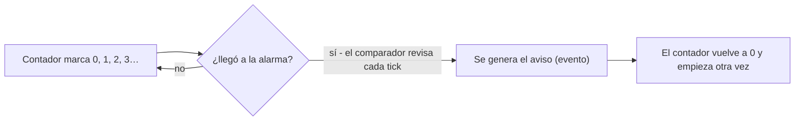
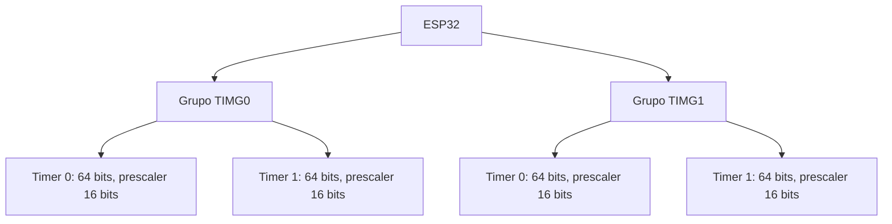
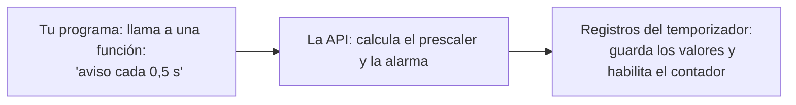
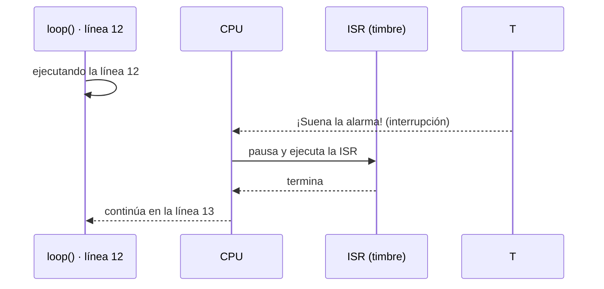
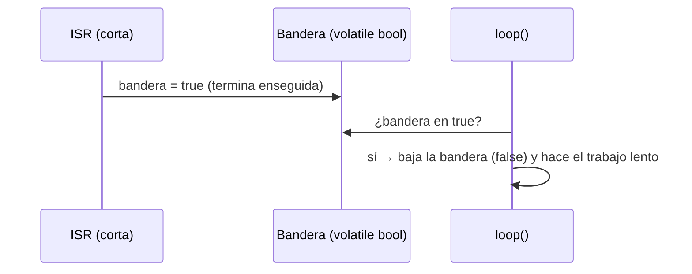

# Semana 3 · Parte 2 — Temporizadores de hardware en el ESP32 (II): autorrecarga, API y cómo se entera la CPU

> Apuntes de clase · Sistemas Digitales · Unidad 1: Microcontroladores para sistemas embebidos
> Autor: Jaime Landazuri · Fuente: RECURSOS/S3_Temporizadores_ESP32.pdf · Universidad Nacional de Loja

## Desarrollo

### Autorrecarga: el aviso se repite solo

**Autorrecarga (auto-reload)**: al alcanzar la alarma, el contador vuelve solo a 0. Así el aviso se repite a intervalos iguales sin que el programa haga nada.

#### Desbordamiento no es lo mismo que autorrecarga

| | Alarma con autorrecarga | Desbordamiento |
|---|---|---|
| Qué valor lo provoca | Uno que tú eliges (ej.: 500 000) | El máximo que cabe en los bits |
| Qué pasa | Aviso y el contador vuelve a 0 | El contador "da la vuelta" a 0 |
| ¿Es intencional? | Sí: es el uso normal | Casi nunca: es el límite físico |

**Pista de atletismo**: la alarma es la línea que tú pintas en el metro 400. El desbordamiento es el final de la pista: si no hubiera línea, el corredor llegaría hasta ahí y empezaría de nuevo por obligación.

#### ¿Cuál es el límite del contador?

Con n bits, el máximo es 2ⁿ − 1:

| Contador | Valor máximo | Con ticks de 1 µs, se llena en… |
|---|---|---|
| 8 bits (Timer0 del AVR) | 255 | 0,26 ms |
| 16 bits (Timer1 del AVR) | 65 535 | 65,5 ms |
| **64 bits (ESP32)** | 18 446 744 073 709 551 615 | ≈ 584 000 años |

> ⚠ En el ESP32 el desbordamiento prácticamente no ocurre: se trabaja siempre con la alarma.

### Los temporizadores del ESP32

#### El ESP32 tiene 4 temporizadores de propósito general

Dos grupos, dos timers cada uno, todos con contador de 64 bits y prescaler de 16 bits:

- **Grupo TIMG0**: Timer 0 · Timer 1
- **Grupo TIMG1**: Timer 0 · Timer 1

Cada uno cuenta hacia arriba o hacia abajo y tiene autorrecarga. Funcionan en paralelo: **hasta 4 avisos periódicos independientes**.

#### ESP32 frente al AVR ATmega328P (semana 1)

| Característica | ESP32 (WROOM-32) | ATmega328P (Uno) |
|---|---|---|
| Temporizadores de uso general | 4 | 3 (Timer0, Timer1, Timer2) |
| Tamaño del contador | 64 bits | 8 o 16 bits |
| Reloj de entrada | 80 MHz | 16 MHz |
| Prescaler | Cualquier N de 2 a 65 535 | Solo 1, 8, 64, 256 o 1024 |
| Se llena (sin prescaler) | Prácticamente nunca | Timer1: en 4,1 ms |

### ¿Cómo le damos órdenes al temporizador?

#### API: el menú del restaurante

**API (Application Programming Interface)**: conjunto de funciones que alguien ya programó para que uno las use sin saber cómo están hechas por dentro.

- El **menú** = la API: la lista de lo que puedes pedir.
- El **pedido** = llamar a una función.
- La **cocina** = el hardware y los registros: no necesitas entrar.

Ya se ha usado: `pinMode()`, `digitalWrite()`, `delay()` y `millis()` son funciones de una API.

#### La API escribe los registros por nosotros

- Es lo mismo que hace `digitalWrite()` con los registros del puerto (semana 1).
- No se escribirán los registros del temporizador a mano, pero se debe saber que existen y qué guardan.

#### Core: el paquete que enseña al Arduino IDE a programar el ESP32

**Core (núcleo)**: paquete de software que se instala en el Arduino IDE para programar una placa concreta. Trae el compilador y la API de esa placa.

- **De fábrica**: el Arduino IDE trae el core de las placas Arduino (Uno, Mega). No sabe programar el ESP32.
- **Para el ESP32**: se instala el core de Espressif, fabricante del chip: "esp32 by Espressif Systems", en Herramientas → Placa → Gestor de placas.

#### Versión 3.x: cambió la API de los temporizadores

1. **3.x** = cualquier versión que empiece por 3: 3.0, 3.1, 3.2…
2. **Qué cambió**: los nombres y parámetros de las funciones de los temporizadores.
3. **Consecuencia**: un código escrito para la versión 2 no compila en la versión 3.

> ⚠ La mayoría de tutoriales de internet usan la versión 2. Copiarlos produce errores de compilación.

### ¿Cómo se entera la CPU de que sonó la alarma?

Interrupción, callback, IRAM_ATTR, volatile y patrón bandera. Las interrupciones externas son de la semana 4.

#### Interrupción: el timbre que te hace dejar lo que haces

- **Interrupción**: señal que un periférico envía a la CPU para decirle "detente, pasó algo". La CPU ejecuta una función especial y **vuelve exactamente adonde estaba**.
- **ISR (Interrupt Service Routine)**: rutina de servicio de interrupción; la función que se ejecuta cuando llega la interrupción.

#### Interrupción del temporizador (hoy) frente a externa (semana 4)

| | Del temporizador (semana 3) | Externa (semana 4) |
|---|---|---|
| Quién la dispara | Un periférico interno: el temporizador llega a la alarma | Un pin que cambia de nivel por algo de afuera |
| Cuándo ocurre | Cada cierto tiempo, de forma predecible | Cuando pasa algo, sin aviso |
| Ejemplo | Encender un LED cada 2 segundos | Detectar que alguien presionó un botón |

> ⚠ Lo que se aprende hoy (ISR, callback, IRAM_ATTR, volatile, bandera) sirve para las dos.

#### Callback: dejar tu número para que te llamen

**Callback**: función que tú escribes, pero que **no llamas tú**: se la entregas a otro para que él la llame cuando ocurra algo.

1. Escribes la función, con lo que quieres que pase cuando suene la alarma.
2. Se la entregas al temporizador, con una función de la API.
3. El hardware la llama cada vez que el contador llega a la alarma. Tu programa nunca la llama.

*Taller mecánico: "llámeme cuando el auto esté listo". Su número es el callback.*

#### IRAM_ATTR: guardar la ISR donde siempre esté a la mano

| Memoria flash | IRAM |
|---|---|
| Chip aparte donde se guarda el programa. Grande y no se borra al apagar, pero lenta y a veces ocupada. | RAM interna rápida para instrucciones (Instruction RAM), dentro del ESP32. Siempre disponible. |

**IRAM_ATTR**: etiqueta que se escribe delante del nombre de la ISR. Le pide al compilador **copiarla a la IRAM**.

> El extintor no se guarda en el sótano con llave: se cuelga en la pared, a la mano.

#### volatile: leer siempre el valor real, no una copia

El compilador traduce el código a instrucciones del chip y además toma atajos para que el programa sea más rápido (optimizando).

| Sin volatile | Con volatile |
|---|---|
| El compilador no ve la ISR. Cree que la variable no cambia, guarda una copia y la reutiliza. `loop()` nunca ve el cambio. | El compilador sabe que algo externo puede cambiarla. La lee de la memoria cada vez. |

> ⚠ **Regla**: toda variable que comparten la ISR y `loop()` se declara `volatile`.

#### Patrón bandera: la ISR avisa, loop() trabaja

**Problema**: la ISR debe ser muy corta, pero a veces queremos hacer algo lento cuando suena la alarma, como imprimir un mensaje.

1. **La ISR solo avisa**: pone una variable en verdadero (true). Esa variable es la bandera. Termina enseguida.
2. **loop() hace el trabajo**: en cada vuelta revisa la bandera. Si está levantada, la baja (false) y hace el trabajo lento.

*Buzón rural: el cartero deja la carta y levanta la banderita; el dueño la ve, la baja y lee con calma.*

## Resumen

1. Un temporizador es un **circuito** que cuenta ticks a un ritmo fijado por el prescaler.
2. **resolución = 1/f** y **alarma = tiempo × f**: con f = 1 MHz la alarma se escribe en µs.
3. La **autorrecarga** repite el aviso en intervalos iguales; el desbordamiento es solo el límite físico del contador (irrelevante en contadores de 64 bits).
4. El ESP32 tiene **4 timers** de 64 bits (2 grupos × 2), en paralelo.
5. La **API** escribe los registros por nosotros; la API cambió en el core **3.x**.
6. La alarma avisa con una **interrupción**: la CPU ejecuta una **ISR** corta (declarada `IRAM_ATTR`), cuyo único trabajo típico es levantar una **bandera volatile** que `loop()` procesa.

## Autoevaluación rápida (pauta de control)

- ¿Puedes explicar qué es un tick y de dónde sale?
- ¿Sabes calcular resolución y alarma para un tiempo dado?
- ¿Puedes describir el camino alarma → interrupción → ISR → bandera → loop()?

## Glosario

- **Autorrecarga (auto-reload)**: al llegar a la alarma el contador vuelve a 0 solo; el aviso se repite sin intervención del programa.
- **Comparador**: circuito que revisa en cada tick si el contador alcanzó la alarma.
- **Desbordamiento**: vuelta del contador al llegar a su máximo 2ⁿ − 1; no es lo mismo que la alarma.
- **TIMG0 / TIMG1**: los dos grupos de temporizadores de propósito general del ESP32 (2 timers cada uno, contadores de 64 bits, prescaler de 16 bits).
- **API**: funciones ya programadas para usar el hardware sin tocar sus registros.
- **Core**: paquete del Arduino IDE con compilador y API de una placa (para el ESP32: "esp32 by Espressif Systems", versión 3.x).
- **Interrupción**: señal que detiene a la CPU momentáneamente; después continúa exactamente donde estaba.
- **ISR**: rutina de servicio de interrupción; la función que ejecuta la CPU al llegar la interrupción. Debe ser muy corta.
- **Callback**: función escrita por nosotros, llamada por el hardware, no por nuestro código.
- **IRAM_ATTR**: atributo que hace copiar la ISR a la IRAM (RAM de instrucciones, siempre disponible) por velocidad.
- **volatile**: obliga al compilador a leer la variable de la memoria cada uso; obligatorio en variables compartidas ISR ↔ loop().
- **Patrón bandera**: la ISR levanta una bandera y termina; loop() la baja y hace el trabajo lento.
