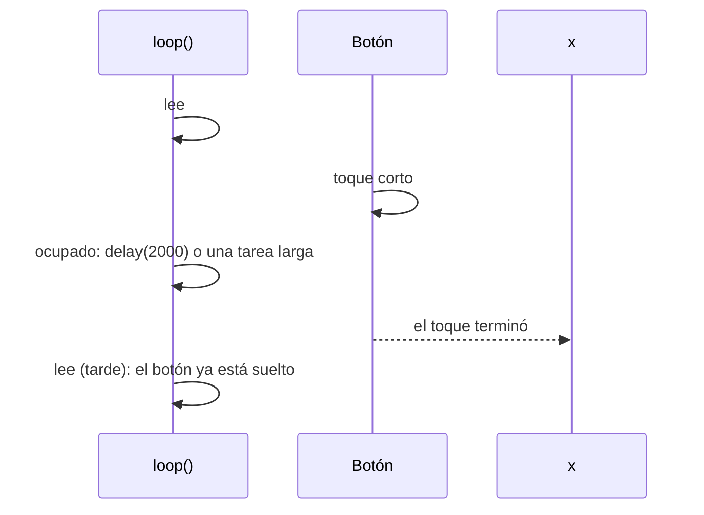
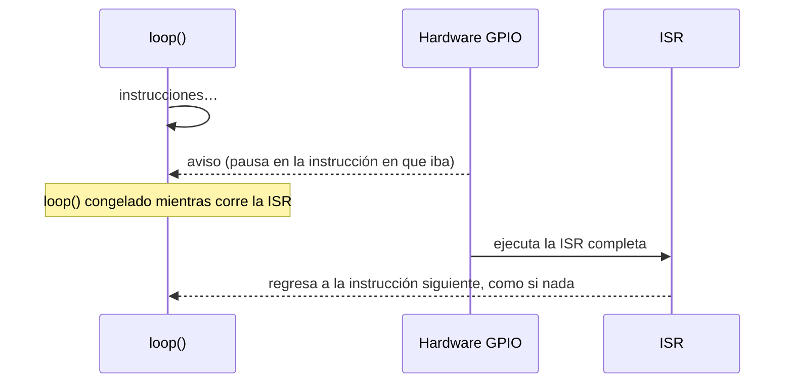
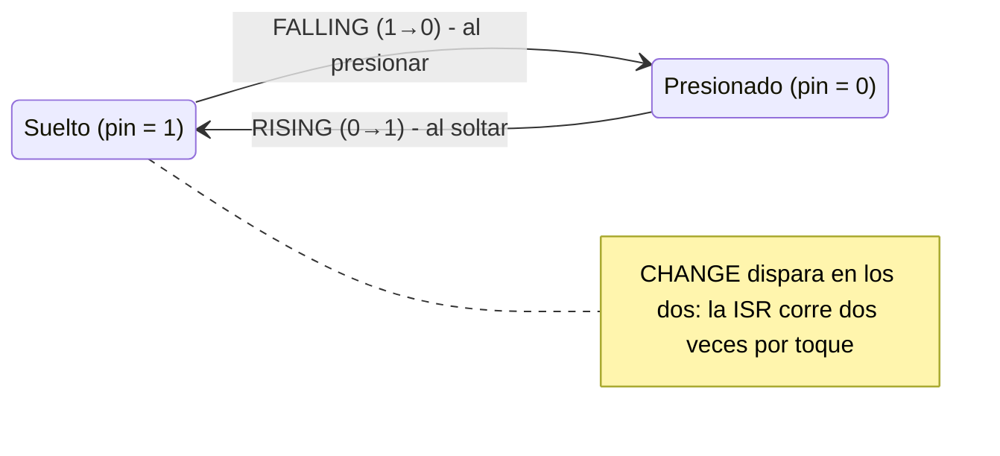
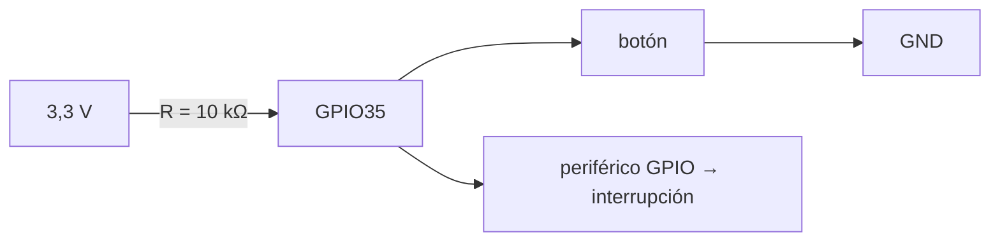

# Semana 4 · Parte 1 — Interrupciones externas en el ESP32 (I): sondeo, flancos, pines y attachInterrupt

> Apuntes de clase · Sistemas Digitales · Unidad 1: Microcontroladores para sistemas embebidos
> Autor: Jaime Landazuri · Fuente: RECURSOS/S4_Interrupciones_Externas_ESP32.pdf · Universidad Nacional de Loja

## Objetivo de la sesión

Explicar cómo el ESP32 detecta eventos externos en un pin mediante interrupciones, y escribir una **ISR correcta** (corta, en IRAM, con variables `volatile` y patrón bandera) para que **ningún evento se pierda**.

| Resultado R1 | Se usa en | Al final |
|---|---|---|
| Diseña arquitectura de microcontroladores. | AP4 del viernes: sistema de alerta doméstica. | Control de aprendizaje: 5 preguntas, 10 minutos. |

### Ruta de hoy

1. Sondeo frente a interrupción · 2. Flancos · 3. Pines que sirven · 4. `attachInterrupt()` · 5. La ISR a fondo · 6. IRAM: dónde vive la ISR · 7. volatile · 8. Patrón bandera · 9. Rebote dentro de la ISR · 10. Todas las piezas juntas.

### Activación: ¿qué hicimos en las semanas 2 y 3?

- **AP2 · Juego de luces**: el `loop()` preguntaba en cada vuelta "¿ya presionaron el botón?" → hoy le ponemos nombre: **sondeo**.
- **AP3 · Temporizador**: el temporizador avisaba solo, sin que el `loop()` preguntara → eso era una **interrupción**.

> Hoy: un botón (como la AP2) que avisa con interrupción (como la AP3).

### Glosario de la clase (1/2)

| Término | Qué significa |
|---|---|
| Sondeo (polling) | Preguntar una y otra vez, en el `loop()`, si algo ya pasó. |
| Interrupción | Aviso del hardware que pausa el programa para atender algo urgente. |
| Interrupción externa | Interrupción cuyo aviso llega desde fuera del chip, por un pin. |
| ISR | Interrupt Service Routine: la función que se ejecuta al llegar el aviso. |
| Flanco | El instante en que una señal cambia de 0 a 1 o de 1 a 0. |
| Rebote | Varios cambios falsos y rapidísimos que produce un botón mecánico. |

### Glosario de la clase (2/2)

| Término | Qué significa |
|---|---|
| Compilador | Programa que traduce tu C a instrucciones del chip. Intenta ahorrar pasos. |
| Registro de la CPU | Casillas muy rápidas dentro de la CPU donde trabaja con copias de datos. |
| Flash | Memoria grande y lenta, fuera del núcleo, donde se guarda el programa. |
| SRAM / IRAM | Memoria rápida dentro del chip. IRAM es la parte para instrucciones. |
| Caché | Copia pequeña y rápida de lo que la CPU leyó hace poco de la flash. |
| Watchdog | "Perro guardián": reinicia el chip si algo se queda trabado mucho tiempo. |

## Desarrollo

### Bloque 1 · Sondeo frente a interrupción

#### Sondeo: mirar por la ventana

*Analogía*: esperas un paquete. Cada 5 minutos te levantas a mirar por la ventana: "¿ya llegó?".

```c
void loop() {
  if (digitalRead(21) == LOW) {
    // ¿ya presionaron?
    encenderAlarma();
  }
  // ...otras tareas...
}
```

En el ESP32, el `loop()` lee el pin en cada vuelta.

#### El problema: si el loop está ocupado, el toque se pierde



Resultado: cuando el `loop()` vuelve a leer, el botón ya está suelto. **El evento se perdió**. En un juego de luces da igual; en una alarma de puerta, no.

#### Interrupción: instalar un timbre

1. **Suena el timbre**: interrupción externa; llega un aviso por un pin.
2. **Vas a abrir**: la ISR atiende el aviso.
3. **Vuelves a lo tuyo**: el programa sigue justo donde estaba.

Nadie mira por la ventana: el aviso llega solo.



#### ¿Quién vigila el pin? El periférico GPIO, no tu código

Cadena: botón se presiona → pin GPIO21 cambia de 1 a 0 → **periférico GPIO detecta el cambio, en hardware** → la CPU pausa el loop y corre la ISR.

El que mira es un **circuito**, no el programa. Por eso el aviso llega aunque el `loop()` esté ocupado en un `delay()`. *Periférico = bloque de hardware del chip que trabaja por su cuenta.*

#### Semana 3 frente a semana 4: el mismo mecanismo

| | Semana 3: temporizador | Semana 4: externa |
|---|---|---|
| ¿Quién toca el timbre? | El temporizador, dentro del chip | Algo de afuera, por un pin |
| ¿Cuándo? | Cada cierto tiempo, fijo | Cuando ocurre el evento |
| Se configura con | `timerBegin`, `timerAlarm`… | `attachInterrupt()` |
| Pausa, ISR, regreso | Igual | Igual |
| ISR, IRAM_ATTR, volatile, bandera | Igual | Igual |

### Bloque 2 · Flancos

#### Nivel frente a flanco

| Nivel | Flanco |
|---|---|
| "La puerta **está** abierta". Un estado que dura. | "La puerta **se acaba de** abrir". Un instante. |

El nivel abarca todo el tiempo en que la señal vale 0 o 1; el flanco es solo ese instante de transición.

#### Recordatorio: con INPUT_PULLUP la lógica es invertida

- **Suelto**: la pull-up interna jala el pin hacia 3,3 V → `1`.
- **Presionado**: el botón une el pin con GND → `0`.

Suelto = 1 · Presionado = 0 (al revés de lo que uno espera).

#### Los tres modos: RISING, FALLING y CHANGE



- **FALLING** (1→0): ocurre al presionar.
- **RISING** (0→1): ocurre al soltar.
- **CHANGE**: los dos: la ISR corre dos veces por toque.

#### Actividad: ¿qué modo usa la alarma?

El botón está en INPUT_PULLUP. La alarma debe sonar en el instante en que alguien presiona. ¿RISING, FALLING o CHANGE?

*Pauta*: con pull-up, presionar hace **caer** la señal (1→0) → **FALLING**. CHANGE usaría los dos flancos (alarma doble por toque); RISING sería al soltar.

### Bloque 3 · Pines

#### ¿Qué pines del ESP32 admiten interrupción?

| Pines | ¿Sirven? | Cuidado |
|---|---|---|
| 16, 17, 18, 19, 21, 22, 23, 25, 26, 27, 32, 33 | Sí | Los recomendados. |
| 34, 35, 36, 39 (solo entrada) | Sí, con cuidado | No tienen pull-up interna. |
| 0, 2, 5, 12, 15 (strapping) | Evitar | Si están presionados al encender, el chip arranca mal. |
| 6 a 11 (flash) | No | Los usa la memoria del programa. |

> En el Arduino Uno solo D2 y D3 podían. En el ESP32, casi todos. AP4: botón en GPIO21.

#### Pines 34–39: hay que poner la pull-up por fuera



- **Sin la resistencia** externa: el pin queda flotando; capta ruido y aparecen alarmas sin que nadie toque.
- **Con la resistencia** (10 kΩ a 3,3 V): suelto = 1 seguro. Hace por fuera lo que la pull-up interna hace por dentro.

### Bloque 4 · attachInterrupt

#### attachInterrupt(): la instalación del timbre

```c
attachInterrupt(digitalPinToInterrupt(21), isrBoton, FALLING);
```

| 1 | 2 | 3 |
|---|---|---|
| ¿Qué pin vigilar? `digitalPinToInterrupt(21)` | ¿A quién llamar? `isrBoton` (sin paréntesis: le das el nombre, no la llamas) | ¿Qué cambio? FALLING, RISING o CHANGE |

En español: *"cuando el pin 21 caiga de 1 a 0, llama a isrBoton"*.

#### Dónde va: una sola vez, en setup()

```c
void setup() {
  pinMode(21, INPUT_PULLUP);  // 1.º
  attachInterrupt(
    digitalPinToInterrupt(21),
    isrBoton, FALLING);       // 2.º
}
```

- **Una sola vez**: el timbre se instala una vez; no cada vez que llega alguien.
- **Orden**: primero `pinMode`, después `attachInterrupt`.
- **`detachInterrupt(pin)`**: desinstala el timbre.

*(Los siguientes bloques —ISR a fondo, IRAM, volatile, patrón bandera, rebote y el programa completo— continúan en Semana4_P2.md)*
