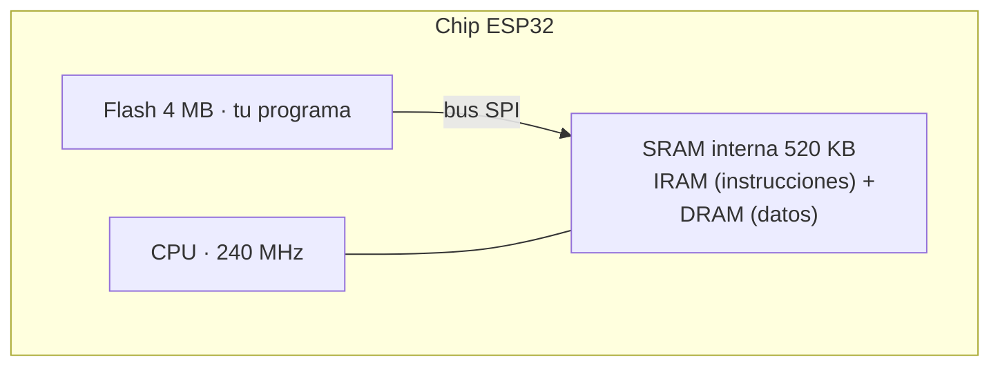
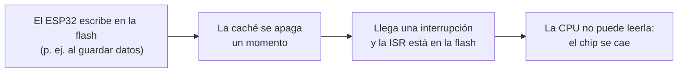
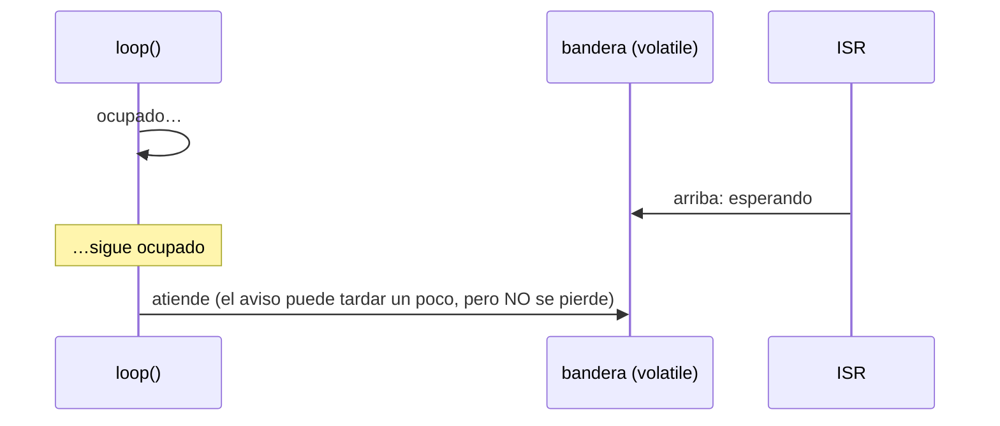

# Semana 4 · Parte 2 — Interrupciones externas en el ESP32 (II): la ISR a fondo, IRAM, volatile y todo junto

> Apuntes de clase · Sistemas Digitales · Unidad 1: Microcontroladores para sistemas embebidos
> Autor: Jaime Landazuri · Fuente: RECURSOS/S4_Interrupciones_Externas_ESP32.pdf · Universidad Nacional de Loja

## Desarrollo

### Bloque 5 · La ISR a fondo

#### ¿Qué es una ISR?

| Función normal | ISR |
|---|---|
| Tú la llamas en tu código, en el punto que decides (`saludar();`) | Tú nunca la llamas. La llama el hardware cuando llega el aviso, en cualquier momento. |

**ISR = Interrupt Service Routine**: rutina de servicio de interrupción; la función que atiende el aviso. En la semana 3 la llamamos *callback*.

#### Analogía: dejar tu número en el taller

1. **Dejas tu número**: `attachInterrupt(…, isrBoton, …)`.
2. **Sigues con tu vida**: el `loop()` hace lo suyo.
3. **El taller te llama**: el hardware ejecuta `isrBoton`.

>Llamar al taller cada hora "¿ya está?" sería sondeo.

#### Regla 1: la ISR debe ser corta

| Sí va en la ISR | ✘ No va en la ISR |
|---|---|
| Subir una bandera | Serial.print / println |
| Guardar el tiempo: millis() | delay() |
| Sumar 1 a un contador | Cálculos largos |
| digitalWrite (es rápido) | Esperar a que algo pase |

*Como el extintor: apagas el fuego y sales. Nada de limpiar la cocina.*

#### Si la ISR tarda demasiado: el watchdog

```mermaid
flowchart LR
    L["ISR larga: Serial, delay…"] --> W["Watchdog detecta
    que algo está trabado"]
    W --> R["Reinicio: el ESP32 arranca de nuevo"]
    R --> S['Monitor Serie: "Guru Meditation Error"']
```

*Analogía*: el guardia de la fábrica ve una máquina trabada demasiado tiempo, la apaga y la vuelve a encender. **El síntoma típico: "el ESP32 se reinicia de vez en cuando"**.

### Bloque 6 · IRAM: dónde vive la ISR

#### Dónde vive el programa: flash y SRAM

CHIP ESP32: **CPU** (240 MHz) — **SRAM interna · 520 KB** (rápida, se borra al apagar; incluye zonas **IRAM** y **DRAM**; conectada a la flash por un bus SPI) — **Flash · 4 MB** (grande, lenta, no se borra al apagar; aquí se guarda tu programa).



*Ojo*: en el ESP32, **DRAM** significa "Data RAM", no la DRAM de las memorias de un computador.

#### IRAM y DRAM: dos zonas de la misma SRAM

- **IRAM · Instruction RAM**: guarda instrucciones: código que la CPU ejecuta. **Aquí pondremos la ISR.**
- **DRAM · Data RAM**: guarda datos: por ejemplo, las variables globales. Aquí vive la variable `alerta`.

#### La caché: cómo la CPU lee rápido de una flash lenta

CPU pide la siguiente instrucción → **caché** (copia de lo leído hace poco) → **flash** (el programa completo, lento).

*Analogía*: la biblioteca (flash) es enorme pero queda lejos. En tu mesa (caché) tienes los libros que usaste hace poco: casi siempre lo que necesitas ya está ahí.

#### El problema: a veces la caché se apaga



Es raro, pero real. Y cuando pasa, casi no se puede reproducir: *"a veces falla y no sé por qué"*.

#### Analogía: el extintor a la mano

- ✘ **En la bodega (flash)**: a veces la bodega está cerrada (caché apagada). Si hay fuego justo entonces, no alcanzas el extintor.
- ✅ **En la pared de la cocina (IRAM)**: siempre a la mano, pase lo que pase.

La ISR es el código de emergencia: tiene que estar siempre a la mano.

#### IRAM_ATTR: "guarda esta función en la IRAM"

```c
void IRAM_ATTR isrBoton() {
  // código corto de emergencia
}
```

`IRAM_ATTR` se escribe **entre el tipo y el nombre**.

- **Si la omites**: funciona casi siempre y falla muy de vez en cuando.
- **Regla**: toda ISR lleva IRAM_ATTR. Siempre.

### Bloque 7 · volatile

#### Dos lugares donde puede estar un dato

| RAM → el pizarrón | Registro de la CPU → tu cuaderno |
|---|---|
| Donde vive la variable `alerta`. La ISR y el `loop()` la pueden ver. | Casillas dentro de la CPU. Para trabajar con un dato, la CPU primero lo copia aquí. |

*No son los registros de periféricos de la semana 2 (GPIO_OUT, GPIO_IN).*

#### El compilador es "ahorrativo"

```c
while (alerta == false) {
  // nada aquí adentro cambia alerta
}
```

El compilador piensa: *"Nadie cambia `alerta` aquí. La copio una vez a mi cuaderno y no vuelvo al pizarrón."*

El problema: el compilador no sabe que existe la ISR. Nadie la llama desde el código: la dispara el hardware. Por eso cree que nadie cambia `alerta`.

#### Analogía: la fecha del examen

1. **Copias del pizarrón**: dice "viernes" y lo copias a tu cuaderno.
2. **El profesor lo cambia**: pone "lunes". El profesor es la ISR.
3. **Miras tu cuaderno**: sigue diciendo "viernes". Nunca te enteras.

Para no perderte el cambio: mira el pizarrón cada vez.

#### Lo mismo, dentro del chip

| Momento | RAM (pizarrón) | Copia en la CPU (cuaderno) | ¿Qué ve el loop? |
|---|---|---|---|
| Arranca el loop | `alerta = false` | false | false |
| La ISR escribe | `alerta = true` | false | false |
| Siguen las vueltas | true | false | false para siempre |

El LED nunca se enciende, y el código "se ve bien": no hay ningún error de compilación.

#### Lo que hace volatile

```c
volatile bool alerta = false;
```

*"Esta variable puede cambiar a tus espaldas. No confíes en tu copia: ve a la RAM cada vez que la uses."*

- En la analogía: mira siempre el pizarrón.
- Solo hace eso: no la hace más rápida ni más segura.

#### La prueba: ¿la usan la ISR Y el loop?

| Variable | ¿La toca la ISR? | ¿La toca el loop? | ¿volatile? |
|---|---|---|---|
| alerta | escribe | lee | **Sí** |
| pulsos | escribe | lee | **Sí** |
| tUltimo | lee y escribe | — | No |
| total | — | lee y escribe | No |

> No importa dónde se escribe, sino **cuántas partes del programa la tocan**.

#### Por qué este error es traicionero

- **Hoy funciona**: con un `Serial.println` en el loop, el compilador suele volver a leer la RAM. Parece que volatile no hacía falta.
- **Mañana falla**: quitas el println o cambias la optimización, y el loop deja de ver la bandera.

### Bloque 8 · Patrón bandera

#### El buzón rural con banderita

| Cartero = ISR | Banderita = variable | Tú = loop() |
|---|---|---|
| Deja la carta y levanta la banderita. Tarda 5 segundos y se va. | `bool volatile alerta`. Arriba = "pasó algo". | Ves la banderita, la bajas y lees la carta con calma. |

El cartero no entra a la casa a leerte la carta en voz alta.

#### División del trabajo

| ISR (rápida) | loop() (con calma) |
|---|---|
| 1. Sube la bandera: `alerta = true` | 1. ¿Bandera arriba? |
| 2. Sale. | 2. La baja: `alerta = false` |
| **Nada más.** | 3. Hace el trabajo pesado: imprimir, sirena, Wi-Fi, LCD… |

> En el loop: **primero bajar la bandera, después trabajar**.

#### La bandera en el tiempo



#### La bandera en código

```c
volatile bool alerta = false;           // 1. la bandera

void IRAM_ATTR isrBoton() {             // 2. la ISR
  alerta = true;                        //    sube la bandera
}

void loop() {                           // 3. el loop
  if (alerta) {                         //    ¿arriba?
    alerta = false;                     //    la baja
    Serial.println("¡Alerta!");         //    trabajo pesado
  }
}
```

#### Limitación: la bandera no cuenta

| Bandera (bool) | Contador (uint32_t) |
|---|---|
| Dice "pasó algo". 3 toques mientras el loop está ocupado = 1 aviso. | Dice "cuántas veces". La ISR suma 1; el loop lo lee. |

```c
volatile uint32_t pulsos = 0;
void IRAM_ATTR isrBoton() { pulsos++; }
```

### Bloque 9 · Rebote dentro de la ISR

#### El rebote: un toque, varios flancos

Un toque produce varios rebotes: 3 flancos de bajada en unos milisegundos → la ISR corre 3 veces.

| Con sondeo (AP2) | Con interrupción |
|---|---|
| El `loop()` filtraba el rebote. | **Cada rebote dispara la ISR**: un toque cuenta como 3 o 5. |

#### Antirrebote dentro de la ISR, con millis()

```c
uint32_t tUltimo = 0;                     // solo ISR

void IRAM_ATTR isrBoton() {
  uint32_t ahora = millis();
  // ¿toque nuevo?
  if (ahora - tUltimo >= 50) {
    alerta = true;
    tUltimo = ahora;
  } // si no: es rebote
}
```

**La idea**: ignorar flancos a menos de 50 ms del último aceptado. Ya se conoce el patrón: es el `ahora − tAnterior` de la semana 2.

### Bloque 10 · Todo junto

#### El recorrido completo de un aviso

| Botón | Periférico | ISR | Bandera | loop() |
|---|---|---|---|---|
| FALLING | GPIO detecta | IRAM_ATTR + antirrebote | volatile | trabajo pesado |

Preguntas del deck: *¿Qué pieza falla si olvidas volatile? ¿Y si olvidas IRAM_ATTR?*

#### Las piezas juntas (1/2): declaraciones e ISR

```c
const uint8_t PIN_BOTON = 21;
const uint8_t PIN_LED   = 19;
const uint32_t T_REBOTE = 50;                // ms

volatile bool alerta = false;                // ISR y loop
uint32_t tUltimo = 0;                        // solo la ISR

void IRAM_ATTR isrBoton() {
  uint32_t ahora = millis();
  if (ahora - tUltimo >= T_REBOTE) {
    alerta = true;
    tUltimo = ahora;
  }
}
```

#### Las piezas juntas (2/2): setup() y loop()

```c
void setup() {
  Serial.begin(115200);
  pinMode(PIN_LED, OUTPUT);
  pinMode(PIN_BOTON, INPUT_PULLUP);
  attachInterrupt(digitalPinToInterrupt(PIN_BOTON),
                  isrBoton, FALLING);
}

void loop() {
  if (alerta) {
    alerta = false;
    digitalWrite(PIN_LED, !digitalRead(PIN_LED));
    Serial.println("¡Alerta! Puerta abierta");
  }
  delay(2000);   // loop ocupado: el aviso NO se pierde
}
```

Nota clave del ejemplo: aun con `delay(2000)` en el loop, el aviso **no se pierde** — esa es la ventaja frente al sondeo.

### Control de aprendizaje (de la clase: 5 preguntas, 10 min, individual, con justificación)

1. **Flanco correcto**: pulsador con INPUT_PULLUP; la alarma debe activarse en el instante en que alguien presiona. ¿RISING, FALLING o CHANGE?
   - *Pauta*: con pull-up, presionar lleva el pin de 1 → 0 → **FALLING**.
2. **¿Cuáles necesitan volatile?** `uint32_t pulsos;  // la ISR suma 1; el loop lee` · `uint32_t tUltimo; // solo la usa la ISR` · `uint32_t total;  // solo la usa el loop`
   - *Pauta*: solo `pulsos` (la tocan ISR y loop). `tUltimo` y `total` las usa un solo actor.
3. **El ESP32 se reinicia**: `Serial.println("toque")` dentro de la ISR; de vez en cuando aparece "Guru Meditation Error". ¿Qué pasa y cómo se corrige?
   - *Pauta*: la ISR tarda demasiado → el watchdog reinicia. Corregir: quitar el print de la ISR, usar patrón bandera (la ISR solo levanta `alerta`).
4. **Sin antirrebote** (T_REBOTE = 0): 10 presiones del botón. ¿Cuántos avisas: exactamente 10, menos de 10 o más de 10?
   - *Pauta*: **más de 10**: cada toque produce varios flancos falsos por rebote, y cada uno dispara la ISR.
5. **Repaso semana 3**: temporizador a 1 MHz (un tick cada 1 µs), alarma = 500 000 con autorrecarga. ¿Cada cuánto se ejecuta la ISR? ¿Cuántas veces por segundo?
   - *Pauta*: tiempo = alarma × resolución = 500 000 × 1 µs = **0,5 s** → **2 veces por segundo**.

## Glosario

- **Sondeo (polling)**: preguntar en el loop() una y otra vez; si el loop está ocupado, el evento se pierde.
- **Interrupción externa**: aviso que llega por un pin, detectado por el periférico GPIO en hardware.
- **ISR**: rutina de servicio de interrupción; la llama el hardware, nunca tu código.
- **Nivel / flanco**: estado que dura frente a instante de transición; RISING (0→1), FALLING (1→0), CHANGE (ambos).
- **Strapping**: pines 0, 2, 5, 12, 15 que el chip lee al arrancar; evitar pulsadores en ellos.
- **attachInterrupt / detachInterrupt**: instala o desinstala el "timbre"; una sola vez, en setup(), después de pinMode.
- **Watchdog**: perro guardián que reinicia el chip si algo se traba demasiado (ISR largas = Guru Meditation Error).
- **Flash / SRAM / IRAM / DRAM**: programa en flash (lenta); SRAM interna 520 KB dividida en IRAM (instrucciones) y DRAM (datos).
- **Caché**: copia pequeña y rápida de lo leído de la flash; se apaga durante escrituras en flash.
- **IRAM_ATTR**: atributo que copia la ISR a la IRAM; obligatorio en toda ISR.
- **volatile**: obliga a leer la RAM en cada uso; obligatorio en variables compartidas ISR ↔ loop().
- **Patrón bandera**: la ISR solo la sube; el loop la baja primero y luego hace el trabajo pesado.
- **Contador frente a bandera**: uint32_t cuenta cuántas veces también; la bandera bool solo dice "pasó algo".
